# STJ Media Viewer · macOS 原生版

独立的 macOS 原生客户端：Swift 6 + SwiftUI（少量 AppKit），与 Windows 版共用同一份
`catalog.db` 素材库（同 schema / 同语义），目标是把 Mac 上「浏览 + 检索 + 轻编辑 + 同步」这条链路做顺手。

- **独立仓库**：本仓库只包含 macOS 端（原 Windows/WinUI 版在 [stj-media-viewer](https://gitcode.com/TMR2333/stj-media-viewer)）
- 语言/UI：Swift 6 + SwiftUI，少量 AppKit（打开面板、Finder、QuickLook 面板、键盘事件）
- 最低系统：**macOS 14 Sonoma**；macOS 26 起自动启用 Liquid Glass 材质
- 版本：**1.40.0**（Liquid Glass 界面 · 平台无关核心 · iPad P0 预览）
- 发行版：[releases](https://gitcode.com/TMR2333/stj-media-viewer-macos/releases) — 最新 `v1.40.0-macos`
- 文档：[实施说明](docs/macos-port.md) · [开发计划](PLAN.md) · [更新日志](CHANGELOG.md) · [移动端范围](docs/mobile-scope.md) · [原始提示词存档](docs/MACOS-PROMPT.md)

## 下载

| 平台 | 版本 | 文件 |
| --- | --- | --- |
| macOS 原生（Universal，Apple Silicon + Intel） | `v1.39.0-macos` | `STJMediaViewer-1.39.0-macos-arm64-x86_64.dmg` |
| Windows（WinUI 3） | `v1.25.0` | [stj-media-viewer releases](https://gitcode.com/TMR2333/stj-media-viewer/releases) |

首次打开（ad-hoc 签名，无 Apple Developer ID / 公证）：右键 App →「打开」→ 再点「打开」。

> 两个平台的数据文件互通：macOS 版打开 Windows 版扫描出来的 `catalog.db` 即可直接浏览、编辑，编辑结果 Windows 版也认得（schema 与 `is_pick` / `__unset__` / 多主题等语义一致）。

## 截图

| 素材库（浅色） | 素材库（深色） |
| --- | --- |
| 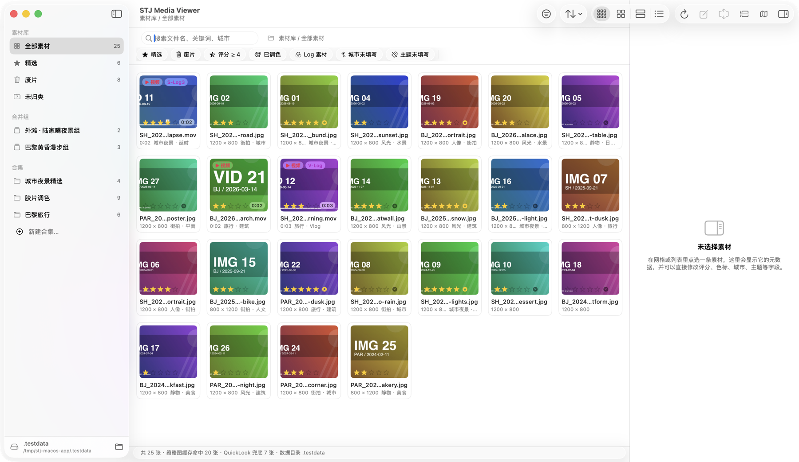 | 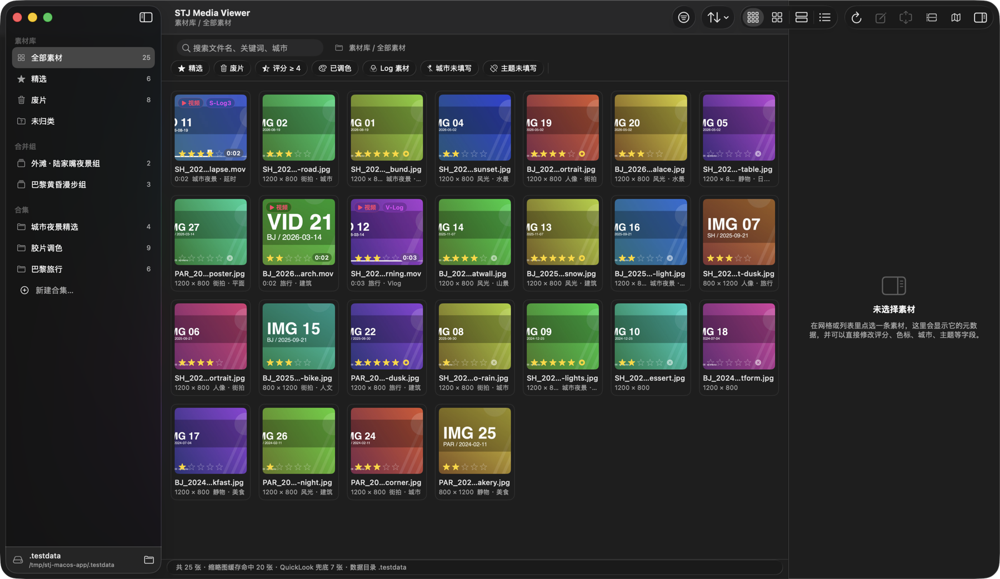 |

| 检视面板 | 画廊（视频 + LUT） |
| --- | --- |
| 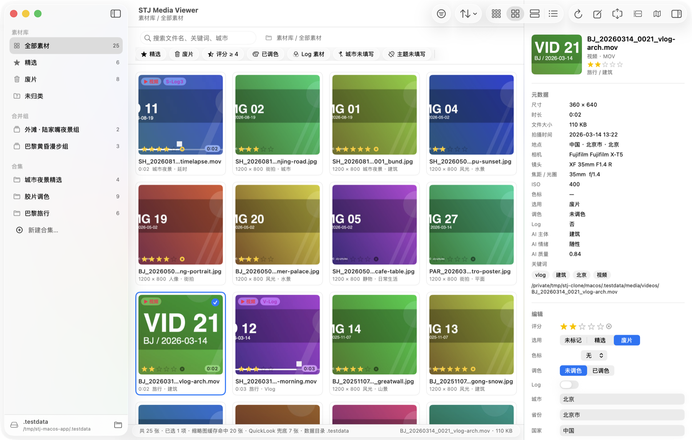 | 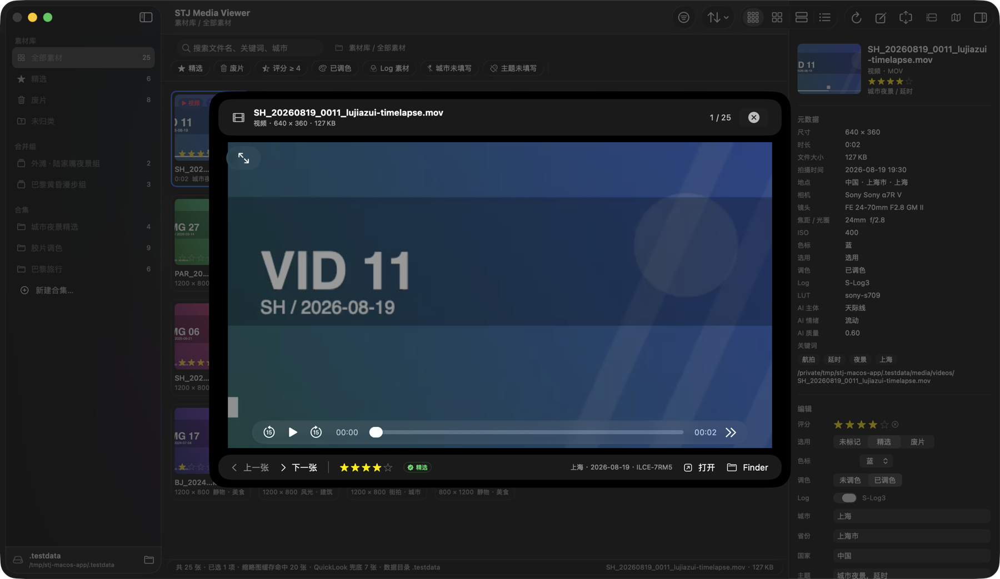 |

| 地图视图 | 时间线 |
| --- | --- |
| 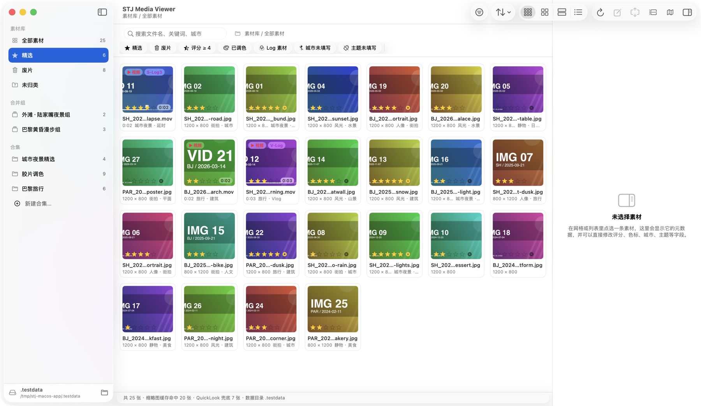 | 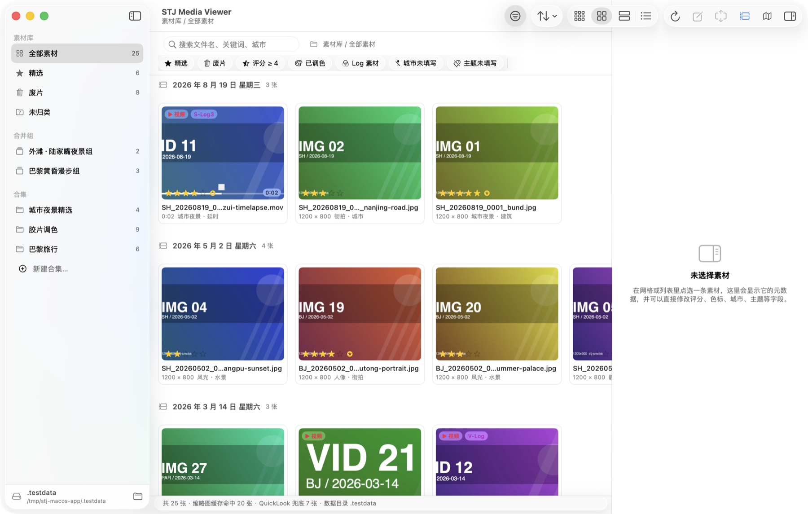 |

| 重复项检测 | 云端浏览 |
| --- | --- |
| 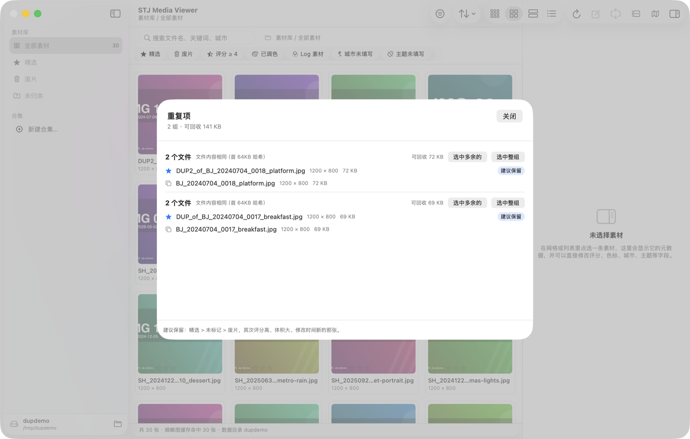 | 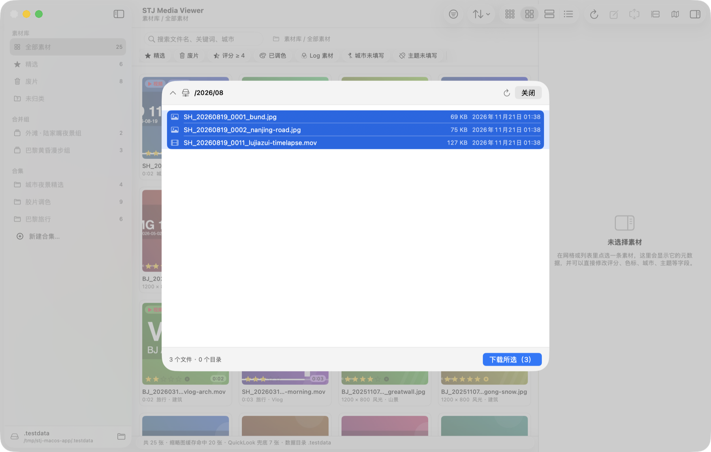 |

| 首次引导 | 云同步设置 |
| --- | --- |
| 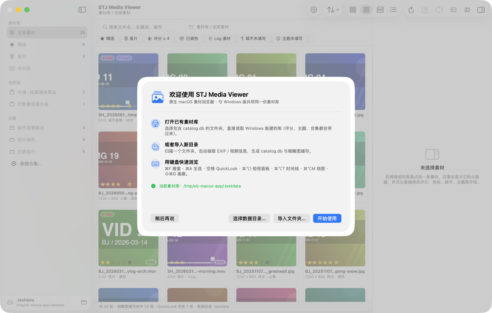 | 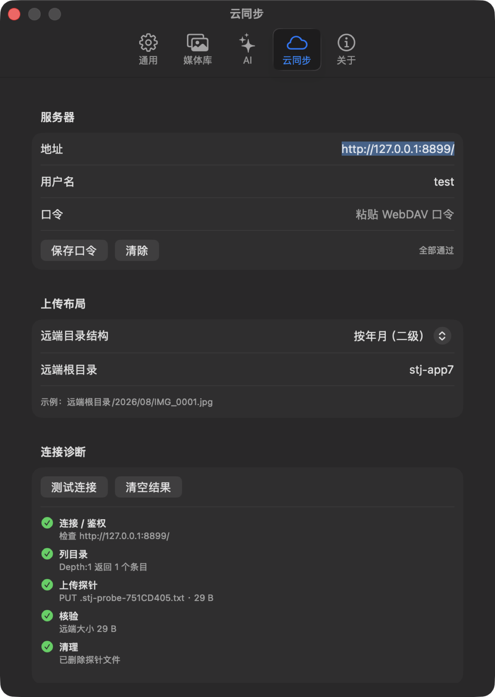 |

| RAW+JPG 合并显示 | 媒体库设置（配对与分库开关） |
| --- | --- |
| 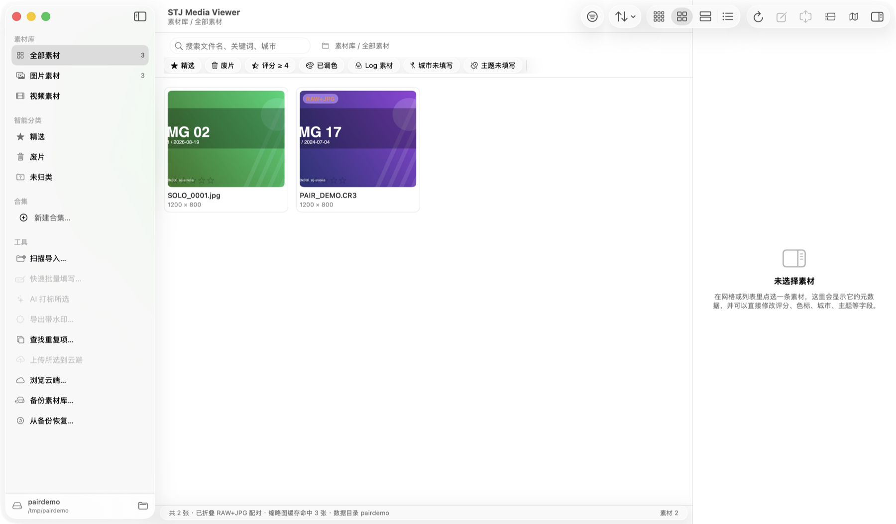 | 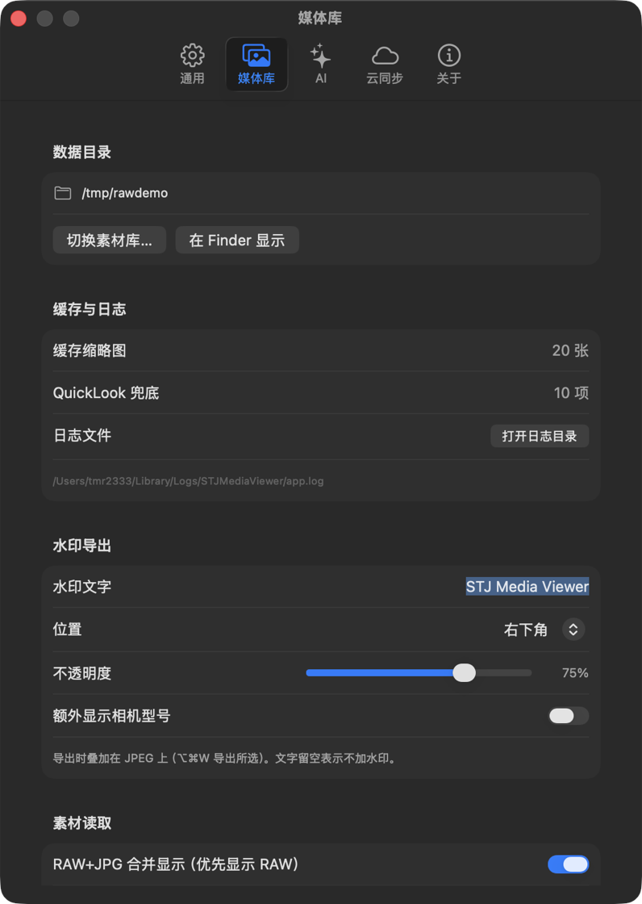 |

| 设置与图片数据迁移（跨平台） |
| --- |
| 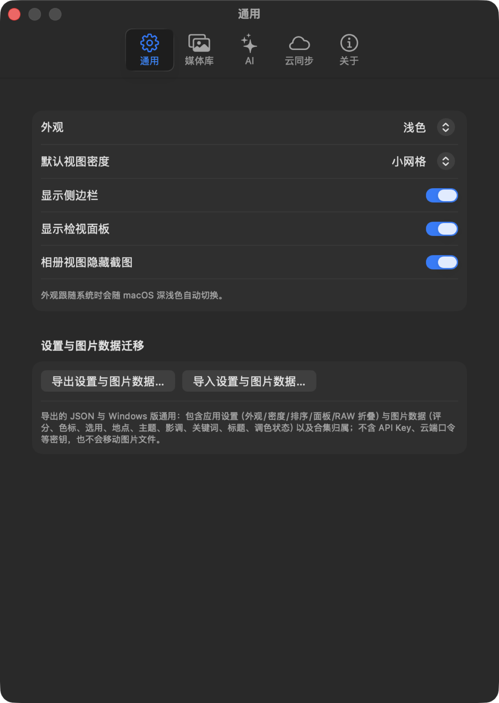 |

**iPadOS / iOS 预览（1.40.1 起，模拟器截图）**

| iPad 网格（侧栏计数 + 图片/视频分库） | iPad 检视面板（评分/色标/元数据） |
| --- | --- |
| 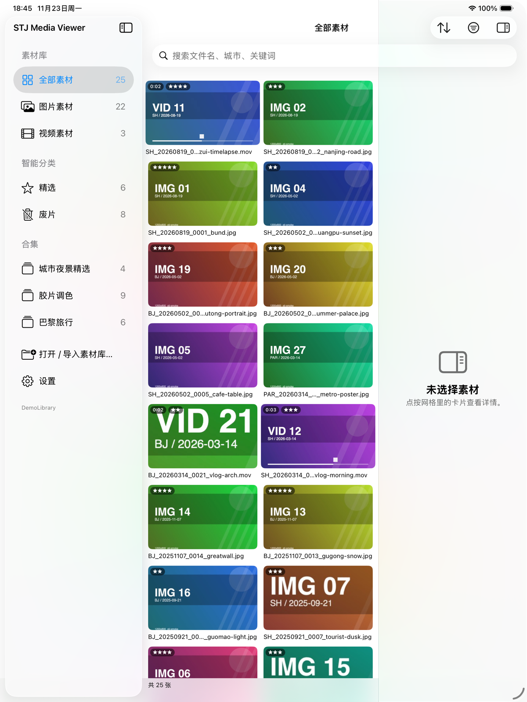 | 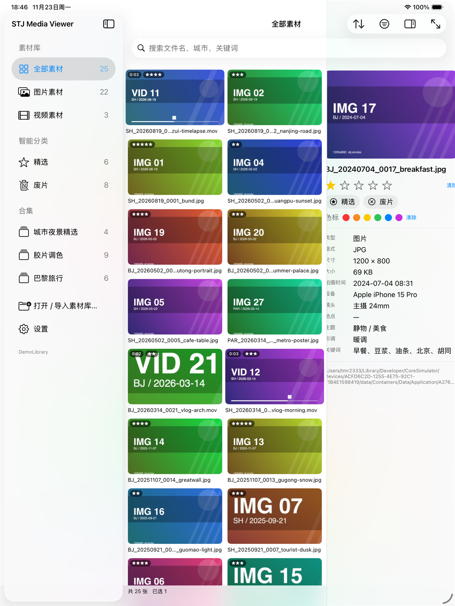 |

> macOS 截图来自 1.40.1 发布包实机运行（主窗口 1800×1053，设置窗口 1120×1576，Retina 2x 缩小）。iPad 截图来自 iOS 26.5 模拟器（iPad Pro 13" M4，2064×2752 缩至 1600 宽）。Liquid Glass 只在 macOS 26 上呈现，旧系统自动回退半透明材质。

## 快捷键

| 场景 | 快捷键 | 说明 |
| --- | --- | --- |
| 通用 | `⌘O` / `⌘I` | 打开素材库 / 扫描导入目录 |
| | `⌘F` | 聚焦搜索框 |
| | `⌘A` / `⇧⌘A` | 全选当前筛选结果 / 取消选择 |
| | `⌘1`–`⌘4` | 小 / 中 / 大网格 / 列表 |
| | `⌘⌥S` / `⌘⌥I` | 侧栏 / 检视面板开关 |
| | `⌘,` | 设置 |
| | `⇧⌘X` / `⇧⌘I` | 导出 / 导入设置与图片数据（跨平台 JSON） |
| 网格 | `空格` | QuickLook 快速预览（系统面板） |
| | `↩` 或双击 | 内置画廊预览（与 Windows 一致） |
| | `⌘↩` / `⌥⌘R` | 用默认应用打开 / 在 Finder 中显示 |
| | `←` `→` `↑` `↓` | 移动选中 |
| | `0`–`5` | 设置评分 |
| | `6` `7` `8` `9` | 色标 红 / 黄 / 绿 / 蓝 |
| | `P` / `X` | 标记选用 / 废片 |
| | `Home` / `End` | 选中首张 / 末张 |
| | `⌘⌫` / `⇧⌘⌫` | 移到废纸篓 / 批量删除 |
| 画廊 | `←` `→` / `Home` `End` | 上一张 / 下一张、首末 |
| | `0`–`5` / `6`–`9` / `P` `X` | 评分 / 色标 / 选用与废片 |
| | `Esc` | 关闭画廊 |
| 素材 | `⌥⌘A` | AI 打标所选 |
| | `⌥⌘D` | 查找重复项 |
| | `⌥⌘P` | 导出 JPG+RAW 配对 |
| | `⌥⌘W` | 导出带水印 JPEG |
| | `⌥⌘U` / `⌥⌘L` | 上传所选到 WebDAV / 浏览云端 |
| | `⌥⌘T` / `⌥⌘M` | 时间线视图 / 地图视图 |
| | `⇧⌘G` | 画廊 |
| | `⇧⌘B` / `⌥⌘B` | 备份 / 恢复素材库 |
| | `⌥⌘E` | 写入 XMP 侧车 |

## 与 Windows 版对齐情况

同一份 `catalog.db`、同一套语义（`is_pick` 三态、`__unset__` 空值并集、多主题命中、缩略图键），交互尽量照搬 Windows 的节奏：

| 维度 | 对齐情况 |
| --- | --- |
| 数据与写入 | ✅ 完全一致：扫描导入、批量编辑、评分/色标/选用、合集、合并组、整理路径回写、XMP 读写、AI 字段 |
| 网格与选择 | ✅ 四档密度（含列表）、框选、⌘/⇧ 多选、方向键、悬停快捷按钮、色标条、合并组/AI 角标 |
| 右键菜单 | ✅ 顺序与 Windows 一致：评分 → 色标 → 选用/废片 → 打开类（含复制路径/文件名）→ 合并组 → AI/XMP/导出 → 合集 → 移入废纸篓（确认框带数量与体积） |
| 快捷键 | ✅ 画廊/网格的 `0–5` `6–9` `P` `X` `←→` `Home/End` 与 Windows 一致 |
| 状态栏 | ✅ 状态文本 9 秒回落「就绪」、素材/筛选/已选计数、错误常驻；进度条覆盖导入/云同步/AI |
| 检视面板 | ✅ 元数据 + 可编辑字段；⌘ 多选时批量立即写入（与 Windows 同策略） |
| 平台差异 | ⚠️ 保留 macOS 原生习惯：搜索框在素材库顶部条、系统 QuickLook（空格）、菜单栏与快捷键表、Liquid Glass 材质；双击=内置画廊、`⌘↩`=外部打开（Windows 用资源管理器双击） |
| 暂未提供 | ⚠️ Windows 的「导入计划/设备枚举/RAW+JPEG 自动配对导入」与「整理撤销」、自动更新器；macOS 侧以扫描导入 + 备份/恢复兜底 |

## 已实现（P0/P1）

| 能力 | 说明 |
| --- | --- |
| 三栏骨架 | `NavigationSplitView`：侧栏（全部素材 / 图片素材 / 视频素材 / 智能分类 / 合并组 / 合集 / 工具）+ 网格/列表 + `.inspector` 检视面板 |
| 打开素材库 | `⌘O` 选择含 `catalog.db` 的目录；记住上次打开的素材库 |
| 扫描导入 | `⌘I` 选目录：没有 `catalog.db` 时按 Windows 兼容 schema 建库；已有库则增量扫描（按路径/大小/修改时间跳过未变文件）；自动生成 `Cache/thumbs` 缩略图并写 `thumb_key`；重复导入保留用户评分/主题等编辑 |
| 网格 / 列表 | 密度小 / 中 / 大 / 列表；`⌘1`–`⌘4` 切换 |
| 选择 | 单击、⌘ 点、⇧ 点范围选择、`⌘A` 全选、方向键移动、Esc 取消 |
| 预览 | `空格` QuickLook（QLPreviewPanel），`↩` 用默认应用打开，右键「在 Finder 中显示」 |
| 画廊 | `⇧⌘G` 全屏画廊：大图 + `←/→` 翻页（在当前筛选结果内循环到头即停）、Esc 关闭 |
| RAW+JPG 合并显示 | 默认开启：同目录同基名的 RAW+JPG 只占一格（优先 RAW，角标写「RAW+JPG」），隐藏 JPG 伴生行；设置 → 媒体库或「查看」菜单可关闭 |
| 筛选 | 类型 / 格式 / 年份 / 城市 / 相机 / 主题 / 影调 / 评分 / 色标 / 选用 / 调色 / Log / 未填写 |
| 快捷筛选 | 精选、废片、评分 ≥4、已调色、Log、城市未填写、主题未填写 |
| 搜索排序 | 文件名/关键词/城市多关键词搜索；拍摄时间/文件名/修改时间/大小/评分/入库时间排序 |
| 检视 + 编辑 | 只读元数据 + 评分、色标、选用（三态）、城市、省份、国家、主题、影调、Log、调色状态 |
| 批量填写 | `⇧⌘E`：只写勾选字段，应用到全部选中项（含合并组成员） |
| 合集 | 新建/重命名/删除、加入/移出所选；侧栏计数 |
| 合并组 | 封面 + 展开组内成员（展开后网格显示全组） |
| 框选多选 | 网格空白处拖动框选（橡皮筋），`⇧` 叠加、`⌘` 反向；空白单击清除选择 |
| 重复项检测 | `⌥⌘D`：按大小/像素/时长聚类后用文件头哈希确认，面板列出分组、可回收空间与建议保留项 |
| 整理动作 | 素材菜单「整理所选 → 复制到… / 移动到…」：按 `{date}/{year}/{city}/{original}` 等模板分目录重命名，重名自动加序号；移动后回写数据库路径 |
| 导出/系统集成 | 拖到 Finder 或其它 App、`⌥⌘P` 导出 JPG+RAW 配对、写入 XMP 侧车、移到废纸篓（回收站） |
| 导入/整理 | 扫描导入（`⌘I`，自动建 Windows 兼容库 + 缩略图 + 增量更新）、重复项检测（`⌥⌘D`）、模板复制/移动；导入时读取 `.xmp` 侧车回填评分/色标/城市/国家/省份/标题/说明/作者/关键词（库内已有编辑优先） |
| 时间线 | `⌥⌘T` 或工具栏按钮：按拍摄日分组的横向缩略图带，日期倒序，未标注日期排最后 |
| 库备份/恢复 | 「文件 → 备份素材库…」`⇧⌘B` 把 catalog.db（含 WAL 边车）+ Cache/thumbs 复制到带时间戳的备份目录并写 `backup-info.json`；「从备份恢复…」`⌥⌘B` 替换库并把旧库改名 `catalog.db.restore-时间戳` 保留 |
| 水印导出 | `⌥⌘W` 导出所选为 JPEG，水印文字/位置/透明度/相机型号在 设置 → 媒体库 配置；从原图（非缩略图）叠加后另存为 `原文件名_水印.jpg` |
| 首次引导 | 首次启动显示欢迎页：选择现有素材库 / 导入目录 / 快捷键速查；可从设置重新触发 |
| AI 打标 | ⌥⌘A 或素材菜单：OpenAI 兼容 `chat/completions`（设置 → AI 填 BaseUrl/模型/Key），图片 data URI 发送；写回多主题首位、影调、关键词并集、AI 主体/情绪/质量分 |
| 地图视图 | `⌥⌘M` 或工具栏「地图」：带 GPS 的素材钉在地图上（缩略图图钉），点选选中、双击进画廊；自动缩放到当前筛选结果 |
| LUT 预览 | 数据目录 `LUTs/` 下放 `.cube` 文件，画廊标题栏「LUT」菜单即时预览（`CIColorCube`，r 最快序解析） |
| 视频播放 | 画廊中视频直接用 `AVPlayerView` 播放（播放/进度/音量/全屏），不再只显示静态封面 |
| 云同步 | WebDAV 上传（设置 → 云同步）：按 平铺/年月/地点/年月+设备 分类，XMP 边车同目录上传，上传后核验远端大小；`⌥⌘U` 上传所选，可取消；设置页「测试连接」跑连接→鉴权→列目录→探针→核验→清理 |
| 侧栏工具区 | 侧栏底部「工具」分区：扫描导入、快速批量填写、AI 打标、导出带水印、查找重复项、上传/浏览云端、备份/恢复，按选中状态自动启用 |
| 设置与图片数据迁移 | `⇧⌘X` 导出 / `⇧⌘I` 导入：把界面设置 + 评分/色标/选用/地点/主题/影调/关键词/标题/调色状态打包成跨平台 JSON（`stj-media-viewer/exchange` v1），与 Windows 版互通；可选「只填空字段」或「覆盖已有值」 |
| 外观 | 跟随系统 / 浅色 / 深色；中文界面；语义字号 |
| 日志 | `~/Library/Logs/STJMediaViewer/app.log`（导航面包屑 `[nav]`、网络一行摘要 `[net]`、5MB 轮转） |
| API Key | 存 macOS 钥匙串（`com.stjarnaperspective.stjmediaviewer`），不写数据库 |

## 跨平台迁移：设置与图片数据导入导出

macOS 与 Windows 共用同一套 `catalog.db` schema，因此编辑数据理论上互通；这个功能解决的是「把编辑成果与界面偏好快速带到另一台机器/另一个平台」。

- **入口**：文件菜单 `⇧⌘X` 导出、`⇧⌘I` 导入；或 设置 → 通用 → 「设置与图片数据迁移」。命令行：`stjcheck --export-exchange 文件.json` / `--import-exchange 文件.json --merge fill|overwrite`。
- **导出内容**：界面设置（外观、密度、排序、面板开关、RAW+JPG 折叠）+ 每条素材的用户编辑（评分、色标、选用三态、国家/省份/城市、主题、影调、关键词、标题、调色状态）+ 合集与成员。
- **不导出**：任何密钥（AI Key、WebDAV 口令）、缓存路径、水印样式（两端水印模型不同）、窗口/日志等本机状态。**不移动/不删除任何媒体文件**。
- **匹配规则**：素材以 `fileName`（小写）+ `sizeBytes` 为主键，`relativePath` 仅用于消歧；匹配不到的条目只在导入预览里统计，不会凭空创建素材行。
- **合并策略**：`fillEmpty`（默认，只填空字段，保留本机已有编辑）/ `overwrite`（用文件里的值覆盖已有值）。
- 格式契约与 Windows 侧实现指引见 [docs/windows-exchange-prompt.md](docs/windows-exchange-prompt.md)。

## 移动端（iPadOS / iOS，实验性）

1.40.0 起 `Sources/STJCore` 已平台无关（去掉 AppKit 依赖），同一份数据模型、SQLite、筛选、
缩略图、导入、AI、LUT、WebDAV、设置迁移都能在 iOS 上编译；`ios/` 下是 iPad P0 的 SwiftUI 界面。

- 代码：`ios/Package.swift`（`STJMobile` 库）+ `ios/Sources/STJMobile/`（侧栏 / 网格 / 检视 / 画廊 / 筛选 / 设置）
- 打包：`bash ios/build-sim-app.sh` 直接产出模拟器 `dist/STJMobile.app`（见脚本注释）
- 范围与路线：[docs/mobile-scope.md](docs/mobile-scope.md)
- 分发：iOS 需要付费 Apple Developer 账号（TestFlight / App Store），仓库只提供源码；macOS 版不受影响

## 构建

```bash
# 一键验证（清单解析 + 构建 + 单元测试 + stjcheck 自检，可按需打包）
bash scripts/verify.sh            # 加 --dmg 顺带产出 universal dmg

swift build -c release            # 只构建本机架构
bash scripts/build-dmg.sh         # universal (arm64 + x86_64) .app + .dmg
# 产物：dist/STJMediaViewer-1.39.0-macos-arm64-x86_64.dmg
```

> 云端 CI：`.cnb.yml` 在 GitCode 的 Linux Runner 上做清单/结构一致性校验；
> 真正的 `.app`/`.dmg` 需要 macOS 工具链（AppKit/SwiftUI/codesign），请在本机或
> 自建 macOS Runner 上执行 `bash scripts/verify.sh --dmg`。检查更新走 GitCode
> Releases API（设置 → 关于，或帮助菜单），不做自动替换（ad-hoc 签名自替换会打断 TCC 授权）。

可选的正式签名与公证：

```bash
export CODESIGN_IDENTITY="Developer ID Application: NAME (TEAMID)"
export NOTARY_PROFILE="stj-notary"
bash scripts/build-dmg.sh
```

没有 Developer ID 时脚本做 ad-hoc 签名，**用户首次打开需要右键 → 打开**（或
系统设置 → 隐私与安全性 → 仍要打开）。

## 直接运行

```bash
open "dist/STJMediaViewer.app"
# 或用启动参数指定素材库（便于自动化/截图验收）
"dist/STJMediaViewer.app/Contents/MacOS/STJMediaViewer" \
  -dataDirectory "$PWD/.testdata"
# 预置选中某条素材（无辅助功能权限时截图用）
... -dataDirectory "$PWD/.testdata" -preselectAssetID <asset-id>
```

## 自检与测试

```bash
cd macos
python3 scripts/make-sample-library.py --data-dir .testdata   # 重建样例库（Windows 全 schema）
swift build --target stjcheck && .build/debug/stjcheck --data-dir .testdata
swift test
```

`stjcheck` 覆盖：schema 兼容、各维度筛选、`__unset__` 并集、多主题命中、`is_pick` 三态、
排序、facet 计数、批量写库、合集 CRUD、合并组展开、XMP packet、缩略图键与缓存命中。
写操作一律在 catalog.db 的临时副本上做，不会污染样例库。

## 快捷键

| 快捷键 | 动作 |
| --- | --- |
| `⌘O` | 打开素材库 |
| `⌘R` | 刷新 |
| `⌘F` | 聚焦搜索框 |
| `⌘A` / `⇧⌘A` | 全选素材 / 取消选择 |
| `空格` | QuickLook 预览（再按关闭） |
| `↩` | 用默认应用打开 |
| `⌘⌫` | 移到废纸篓 |
| `⇧⌘E` | 批量填写 |
| `⌘⌥I` | 显示/隐藏检视面板 |
| `⌘1`–`⌘4` | 小/中/大网格、列表 |
| `⌘,` | 设置 |
| `⇧⌘G` | 画廊查看 |
| 方向键 | 移动选中（网格按行 4 个）；画廊内 `←/→` 翻页 |

## 数据契约（与 Windows 端一致）

- `is_pick` 三态：`1` 精选、`0` 废片、`NULL` 未标记（**不能**用「不等于 1」当废片）
- 未填写伪值 `__unset__` 在 Mac 端按 `IS NULL OR ''` 处理；与具体值筛选是**并集**
- 多主题：`themes_json` 数组，第一个是主主题 `theme`；按任意主题筛选都应命中
- 缩略图键：`路径 + 大小 + 修改时间 + 编辑状态 + LUT` 的 SHA-1（40 hex），缓存目录 `Cache/thumbs`
- 移动/重命名素材时同步更新 `full_path` 与 `file_name`（P2 整理功能实现时）
- 写库使用 SQLite 读写连接 + `busy_timeout`，写操作在事务内完成；WAL 库请连 `-wal/-shm` 一起拷贝

## 扫描导入（命令行等价入口）

```bash
# 扫描一个目录并写库（目录内无 catalog.db 会自动新建），打印新增/更新/跳过/缩略图数量
swift run -q stjcheck --import /path/to/media-folder
# 导入后可以接着用 app 打开该目录，或用自检确认库结构
swift run -q stjcheck --data-dir /path/to/media-folder
```

## 截图

`shots/` 下为浅色与深色调的验收截图（真实 app 以 `screencapture -l <windowid>` 截取，非设计稿）。
1.36.0 起截图体现 **Liquid Glass**：顶部筛选 chip 为玻璃胶囊、底部状态条为悬浮玻璃条、
画廊上下工具栏为深色玻璃浮层（见 `gallery-dark.png` / `main-dark.png`）。
主界面 `main-light.png` / `main-dark.png`，检视面板 `inspector-light.png` / `inspector-dark.png`，
画廊 `gallery-light.png` / `gallery-dark.png`，重复项面板 `duplicates-light.png`，
XMP 回填后的检视面板 `inspector-xmp-light.png`（导入 `/tmp/xmpdemo` 后截图），
云同步设置页与上传进度 `cloud-settings-light.png` / `cloud-settings.png`、`cloud-sync-light.png` / `cloud-sync-dark.png`，
时间线 `timeline-light.png` / `timeline-dark.png`，画廊内视频播放 `video-gallery-dark.png`，
地图视图 `map-light.png`、画廊 LUT 预览 `gallery-lut-dark.png`、AI 打标结果 `inspector-ai-light.png`、
水印导出样例 `watermark-export.jpg`、首次引导 `onboarding-light.png`。

## 已知限制

- 从卡片拖到 Finder 只拖当前文件（SwiftUI `onDrag` 单 provider 限制）；JPG+RAW 配对导出用 `⌥⌘P` 菜单/快捷键，真正多文件拖拽待改用 `NSDraggingSession`
- 无 Developer ID 证书：发行版为 ad-hoc 签名，首次打开需右键 → 打开；如需分发给他人，建议用 Developer ID 签名 + 公证
- 本机若未授予「辅助功能」，外部脚本无法点击 UI；验收截图可用 `-preselectAssetID` / `-galleryAssetID` / `-openSettingsOnLaunch` 等启动参数
- Liquid Glass 需要 macOS 26（Tahoe）；macOS 14–15 自动回退为系统材质（`.regularMaterial`），布局一致
- AI 打标依赖 OpenAI 兼容接口（可填本机 mock），LUT 需自备 `.cube` 文件（放进 `数据目录/LUTs/`）

## 实现进度（M0–M5）

- **M0 数据层**：模型 / SQLite / Catalog 读写 / 缩略图 / 日志 / Keychain / XMP ✅
- **M1 P0**：三栏骨架 / 打开素材库 / 网格 / QuickLook / 双击 / 深浅色 / 设置 / 菜单 / 窗口恢复 / dmg ✅
- **M2 P1**：筛选全维度、快捷筛选、搜索、排序、密度、RAW+JPG 折叠、框选多选、配对导出、检视与批量编辑、合并组、合集、画廊 ✅（多文件拖拽待做）
- **M3 P2**：扫描导入（1.26.0）、重复项与整理（1.27.0）、XMP 读取回填（1.28.0）✅
- **M4 P3**：时间线与视频播放（1.30.0）、地图与 LUT（1.31.0）、AI 打标（1.32.0）✅
- **M5 P4**：WebDAV 上传与诊断（1.29.0）、双向同步/云端浏览（1.35.0）、水印与引导（1.33.0）、备份恢复与关于（1.34.0）✅
- **1.36.0**：Liquid Glass 界面适配（macOS 26+）
- **1.37.x–1.39.0**：Windows 交互对齐、检查更新、侧栏工具区、跨平台设置迁移、RAW+JPG 合并与图片/视频分库
- **1.40.0**：`STJCore` 去 AppKit 化（iOS 可编译）+ iPad P0 预览（侧栏/网格/检视/画廊/筛选/设置）

## 目录

```text
.
├── Sources/STJCore/          # 模型、SQLite、Catalog、缩略图、日志、Keychain、XMP、QuickLook、WebDAV、LUT、AI
├── Sources/STJMediaViewer/   # SwiftUI App：三栏、工具栏、检视、设置、菜单、快捷键、Liquid Glass
├── Sources/stjcheck/         # 命令行自检（含 --import / --dav-*）
├── Tests/STJCoreTests/       # XCTest（72 项）
├── Resources/                # Info.plist、AppIcon.png
├── scripts/build-dmg.sh      # universal 构建 + 签名 + dmg
├── scripts/make-sample-library.py
├── tools/MockWebDav/         # 测试用 WebDAV mock
├── tools/MockAiServer/       # 测试用 OpenAI 兼容 mock
├── ios/                      # iPadOS/iOS 端（STJMobile 库 + App 入口 + 模拟器打包脚本）
├── docs/                     # 实施说明、移动端范围与原始提示词存档
├── shots/                    # 验收截图
├── PLAN.md / CHANGELOG.md
└── Package.swift
```