# stj-media-viewer

> **Stjarna PERSPECTIVE 出品 · co-worked with DeepSeek Harness**

面向专业创作者的 **Windows 原生素材整理软件**。选一个媒体库文件夹，它递归扫描、排除非媒体、解析元数据、自动分类，并给你一个能按 9 个维度检索的素材库。界面遵循**微软 Fluent 设计语言**（WinUI 3 原生、Mica 背板、Segoe UI Variable 字阶），支持跟随系统 / 浅色 / 深色。

<p align="center">
  
</p>
<p align="center">
  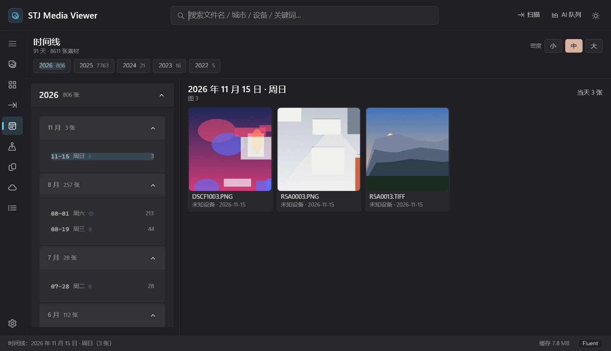
  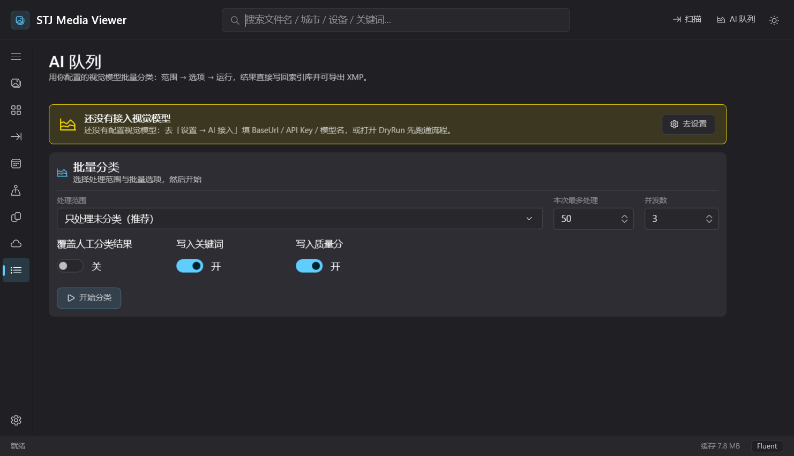
</p>
<p align="center">
  
  
</p>

> 截图由应用自身渲染导出（`STJ_CAPTURE=<png>` 环境变量），不依赖外部截屏工具。

<p align="center">
  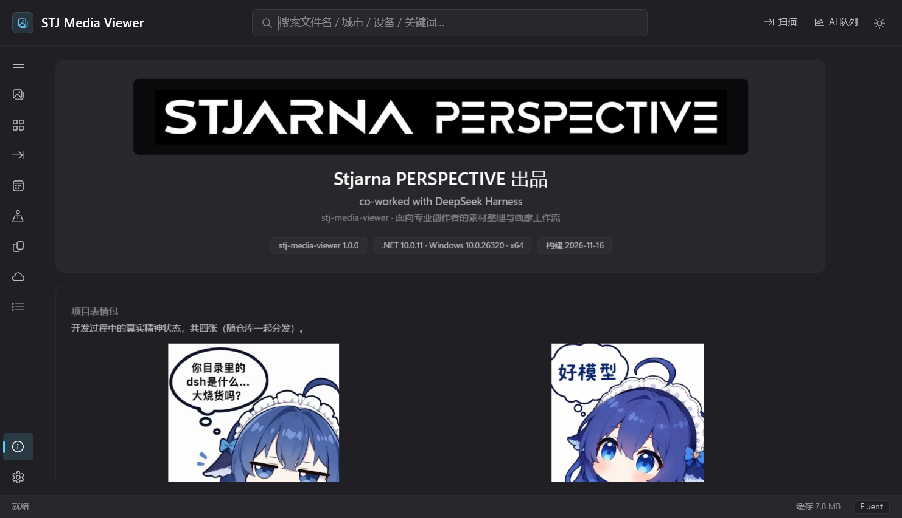
</p>

---

## 1. 它解决什么问题

专业创作者的硬盘里通常躺着几万条素材：相机 RAW、手机 HEIC、无人机视频、Log 素材、现场录音、修过的成片和没修的原片混在一起，散落在 `2023/上海/`、`导出/`、`Desktop/` 之类的目录里。传统文件管理器只能按文件名和日期看，Lightroom/Capture One 又把你锁在单一后期工作流里。

这个软件把"素材整理"本身当成第一性问题：**先把素材变成结构化数据，再让你用任何维度去看它**。

## 2. 功能清单

### 2.1 扫描与排除

- 选择一个或多个媒体库文件夹，递归扫描（可关子目录）。
- **自动排除非媒体**：扩展名白名单 + 魔数嗅探（`.jpg` 里装的是文本会被识别为损坏而不是图片）、AppleDouble `._*`、隐藏文件、`Thumbs.db`/`.DS_Store`/`desktop.ini`、`$RECYCLE.BIN`、`System Volume Information`、`node_modules`、`.git`、临时文件（`.tmp/.part/.crdownload`）。
- 单文件解析失败不中断整体扫描：坏文件照样入库并标记 `LastError`，可用「只看问题」筛出来。
- 扫描进度实时（枚举 / 读元数据 / 写索引三段），可取消。
- 增量重扫：按完整路径 UPSERT，不会产生重复记录；同时清理已从磁盘消失的条目。

### 2.2 元数据引擎（自研，不依赖外部 exe）

| 类型 | 覆盖 |
|---|---|
| 图片 | JPEG / PNG / TIFF / HEIF / AVIF / WebP / BMP / GIF / PSD |
| RAW | CR2 / CR3 / NEF / NRW / ARW / SRF / RAF / ORF / RW2 / PEF / SRW / X3F / DNG / IIQ / 3FR / MOS / GPR … |
| 视频 | MP4 / MOV / M4V / MKV / WebM / MXF（基础）/ AVI（基础） |
| 音频 | WAV（含 RF64）/ MP3（ID3v2.2–2.4）/ FLAC / OGG / Opus / AIFF / M4A(AAC) |

解析内容：EXIF / IPTC / **XMP**（内嵌 APP1、TIFF tag 700、PNG iTXt、WebP、以及 `.xmp/.dop/.cos/.on1/.pp3/.arp` 边车）、ISOBMFF 盒子（时长/尺寸/帧率/编解码器/`colr` CICP/`udta` 的 make/model/GPS/creation_time/comment）、Matroska EBML、ID3/Vorbis 标签、**RAW 内嵌预览提取**（TIFF IFD 513/514 快路径 + 全文件流式扫描最大 JPEG，60MB 大 RAW 12ms）。

### 2.3 九个分类维度

| # | 维度 | 自动来源 | 手动 | AI |
|---|---|---|---|---|
| 0 | 大类（图片/视频/音频） | 扩展名 + 魔数 | — | — |
| 1 | 文件格式 | 扩展名 + 容器/编解码器 | — | — |
| 2 | 拍摄设备 | EXIF Make/Model、QuickTime、文件名 | ✓ | — |
| 3 | 拍摄时间 | EXIF DateTimeOriginal + 时区、QuickTime creation_time、文件时间兜底 | ✓ | — |
| 4 | 拍摄地点（城市） | GPS → **离线城市库**（31,701 城市，含中文名）；XMP `photoshop:City` 优先 | ✓ | — |
| 5 | 是否已后期调色 | XMP `crs:HasSettings`、边车存在、RAW+同名 JPG、文件名启发式 | ✓ 三态 | — |
| 6 | JPG / RAW（RAW 特殊标记） | 扩展名 + RAW 格式库 | — | — |
| 7 | 视频是否 Log | CICP transfer、相机型号、容器内字符串、XMP | ✓ | ✓ |
| 8 | 拍摄主题 | — | ✓ | ✓ 视觉模型 |
| 9 | 拍摄影调 | 直方图/饱和度/色温规则建议 | ✓ | ✓ 视觉模型 |

每个维度的取值都带**来源与置信度**（`Derived` / `Sidecar` / `Manual` / `Ai` + model id），界面上以徽标显示；**人工结果永远优先，AI 默认不覆盖人工值**。

### 2.4 AI 分类：接你自己的模型

- 只要求 **OpenAI 兼容协议**（`POST {BaseUrl}/chat/completions`），因此 OpenAI / Azure OpenAI / Ollama / vLLM / 任意自建网关都能用。
- 设置页填 BaseUrl、模型名、API Key（**DPAPI 加密**后落盘），「测试连接」直接告诉你延迟、模型回显或错误原文。
- 图片会先经 WIC 解码 + 缩放到 `MaxImageDimension`（默认 1024）再以 base64 上传；RAW 自动使用内嵌预览。
- `response_format` 三级回退：json_schema → json_object → 纯文本解析（兼容 markdown 代码块、中文引号、百分制分数等脏输出）。
- 批量队列：并发度可调、失败重试 + 指数退避、进度/耗时/成功率统计、结果可一键写回 XMP。
- **没有 API Key 也能验证全链路**：仓库自带 `tools/MockAiServer`（纯标准库 Python，确定性输出），设置页把 BaseUrl 指向 `http://127.0.0.1:8787/v1` 即可。

### 2.4.1 快捷筛选与拖拽出库

- **筛选栏随媒体类型收敛**：媒体类型只勾「视频」时，顶部只留「只看 Log」；只勾「图片」时只留「只看 RAW」——避免出现必然 0 条的组合（切换时会自动清掉失效的那个条件）。
- **只看未调色 / 只看已调色**：「调色」把两种状态都算进去——标记为**已后期**，或者**已经套用 LUT**；未调色则要求两者都没有。两个开关互斥。
- **拖拽到修图软件**：卡片可以直接拖到 Photoshop / Lightroom / Capture One / 达芬奇 / 资源管理器等任意接受文件拖放的目标。拖的是**磁盘上的真实文件**（JPG+RAW 配对时两个文件一起给），目标程序按路径打开，不需要先导出。多选后拖其中一个，会带上整批选中的素材。

### 2.4.1.1 筛选面板修复：可选值跟着数据走

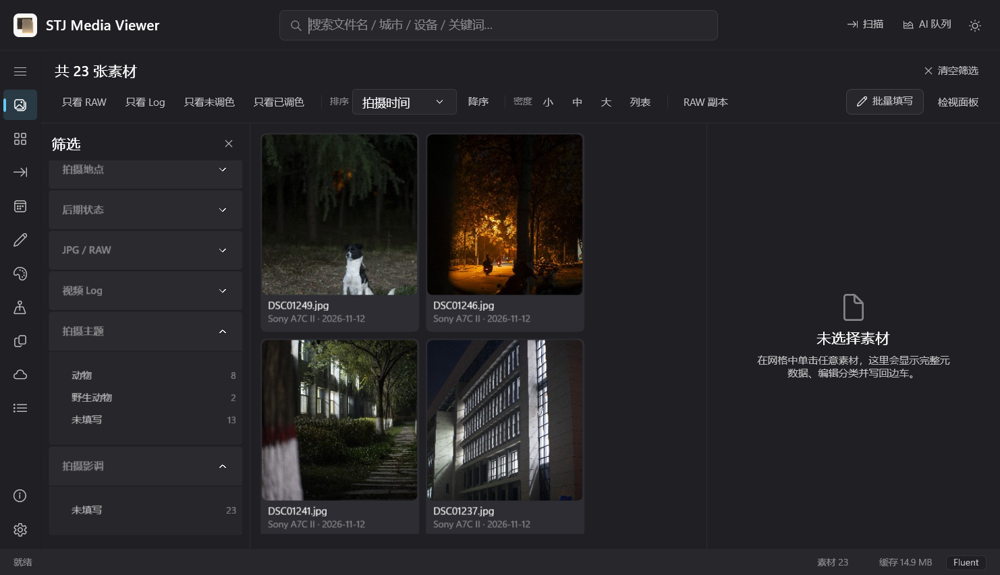

之前的问题：**「拍摄主题」是空的、点了也筛不出东西**。原因是筛选面板的可选值只在启动时构建一次 ——
如果那一刻库还没扫完（或 AI 分类还没跑），主题/城市/设备等分面是空的，之后新分类出来的值
**永远不会补进面板**，看起来就像"不能筛选"。

现在的行为：

- 每次刷新都按最新分面数据**同步**选项集合：集合变了就重建（保留已选），只变计数就原地更新；
- 主题/影调新增「**未填写**」选项（筛选还没分类的素材），伪值 `__unset__` 在 SQL 层展开成 `IS NULL OR ''`；
- 没有任何可选值的筛选组**自动隐藏**，不会再出现空荡荡的分组；
- 展开状态改为双向绑定（切页面不丢）。

### 2.4.1.2 地点单框 + 自定义类别维度

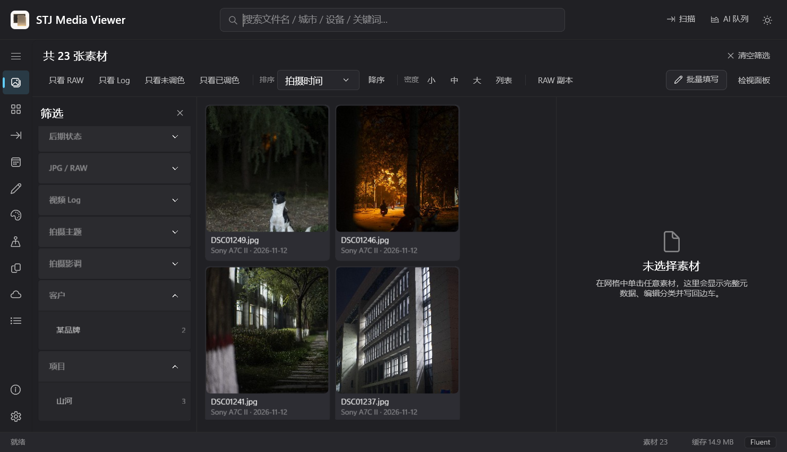

**地点只给一个空**：批量填写页与检视面板不再拆「国家 / 省份 / 城市」三个框，改成一个
「具体地点」自由输入（`上海·外滩` / `西湖断桥` / `巴黎`），写入 `city` 列并标记为手工来源；
筛选面板的「拍摄地点」直接用它。

**自定义类别（用户自建维度）**：

- 维度名自由（例如 `项目`、`客户`、`场地`），值也自由；一个素材在一个维度下只有一个值，改了就是覆盖；
- **批量填写**：勾「自定义类别」→ 选/输入类别 → 填值，一次写一批；
- **检视面板**：显示该素材已有的自定义类别（每行可删），下方可直接「类别 + 值 → 添加」；
- **筛选面板**：出现过的每个维度自动生成一个筛选分组（多选 = 同维度 OR，跨维度 AND），维度没数据时分组自动消失；
- 存储：`asset_custom(asset_id, dimension, value)` 独立表，删素材时级联清理；不动 `assets` 表结构。

### 2.4.2 新用户引导（首次启动自动进入）

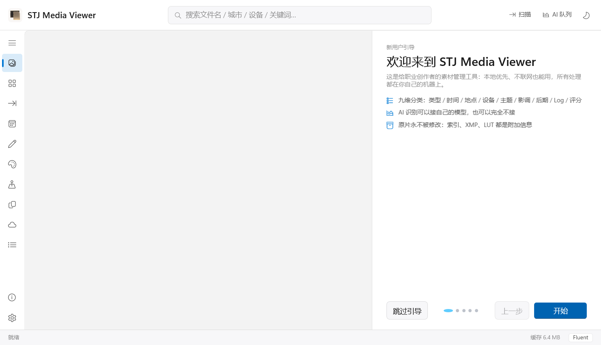

五步走完，功能演示与关键设置一次搞定。**左侧是纯 HTML/CSS 动画演示（WebView2 承载）**：扁平、浅色、只有图形没有文字；右侧是原生步骤面板，负责说明与选项。

| 步骤 | 讲的什么 | 让你选的 |
| --- | --- | --- |
| 1 欢迎 | 九维分类 / AI / 原片只读 | — |
| 2 素材库 | 扫描建立索引 | **选一个素材文件夹**（只读扫描，可跳过） |
| 3 AI 识别 | 接自己的模型 | **BaseUrl / API Key / 视觉模型** + 一键测试连接（可跳过） |
| 4 偏好 | 日常顺手程度 | **Sony Log 自动套官方 LUT**、**完成后后台预热缩略图**、**缩略图缓存上限** |
| 5 完成 | 刚才选择的摘要 | 「完成」进入素材库 |

- **主题切换**：引导期间整窗固定浅色（含标题栏、导航栏、状态栏 —— Mica 背板会跟随系统深色，所以引导时临时切成纯色背板）；点「完成」后**切成深色**并落盘，之后照常跟着设置走。用户在设置页重播引导时，结束后恢复原来选择的主题。
- **可重播**：设置 → 关于 → 「重新播放新用户引导」（`ShowOnboarding(replay: true)`）。
- **跳过**：任何一步都能「跳过引导」，保留默认设置，直接进素材库。
- **降级**：没装 WebView2 运行时（Win11 一般自带）时，左侧显示静态说明，右侧设置照常可用；引导本身不依赖动画。
- 实现：`Views/OnboardingPage.xaml(.cs)` + `Assets/Onboarding/onboarding.html`；`Settings.OnboardingCompleted` 决定是否显示。

动画五幕（都是纯 CSS，无文字、无渐变、无投影）：

| 幕 | 画面 |
| --- | --- |
| 1 | 扁平蓝色方块徽记 + 呼吸的同心圆角框 + 逐格点亮的小方点 |
| 2 | 文件夹落下，卡片网格逐张浮入，扫描线掠过，底部索引条生长 |
| 3 | 九宫格被扫描光带上下刷过，标签胶囊逐个弹出 |
| 4 | 同一张扁平插画（天空/太阳/山丘/建筑）在灰度与彩色之间被一条竖线反复擦除对比，下方曲线绘制 |
| 5 | 圆环与对勾描边绘制，三个小胶囊顺序浮现 |

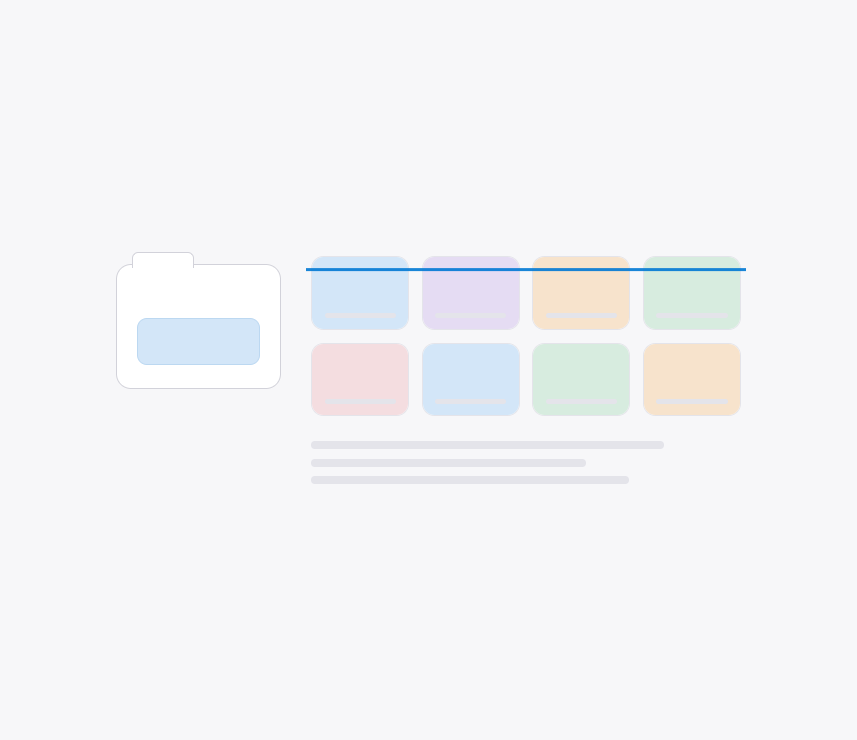

### 2.4.3 界面动画（本轮打磨）

- **缩略图淡入**：图片加载完成后 190ms 淡入，列表虚拟化反复重建时不再"啪"地闪现。
- **网格过渡**：`AddDeleteThemeTransition` / `RepositionThemeTransition` / `ContentThemeTransition` —— 改筛选、增量加载、排序变化时卡片是移位/入场，不是硬切。
- **检视面板滑入**：`EntranceThemeTransition`（横向 24px）+ `RepositionThemeTransition`，选中素材时面板内容滑入。
- **页面导航**：所有主页面切换统一 `EntranceNavigationTransitionInfo` 入场过渡。

### 2.5 整理与输出

- 三栏素材库：**左侧 11 组分面筛选（带计数）+ 中间虚拟化网格 + 右侧检视面板**。
- 网格：小/中/大/列表四种密度、RAW/LOG/AI/时长徽标、颜色标签条、5 星评分、多选（Ctrl/Shift）、方向键导航、右键菜单、200 条/页滚动加载。
- 检视面板：大图预览、8 组元数据（带来源徽标）、手动分类（主题/影调/后期三态/城市/评分/色标/选用废片）、保存 / AI 分类此条 / 写入 XMP。
- 全屏预览：滚轮指针锚点缩放 0.1–8x、拖拽平移、双击 1:1、左右切图、视频/音频播放。
- 时间线（年/月/天）、地图（城市分布）、AI 队列；画廊与查重已合并进素材库工具条（不再是独立导航页）。
- 批量导出（按 `{yyyy}/{city}/{device}` 模板分目录，可移动或复制，边车一起带走）、批量重命名（模板变量）、回收站删除。
- 重复检测：`size + 快速 FNV 指纹` 粗筛 → `SHA-256` 精确 → `8x8 aHash` 近重复。
- 缩略图磁盘缓存 + 内存 LRU；缓存大小可见、可清理。

### 2.6 外部存储设备 → 导入（JPG 预览 + RAW 同步）


- **读外部存储**：枚举 U 盘 / SD 卡 / 相机 / 移动硬盘（`DriveInfo` 快枚举 + `IOCTL_STORAGE_QUERY_PROPERTY` 探总线类型，所以「USB 接进来的固定盘」也能认出来），显示卷标、盘符、文件系统、容量条与剩余空间；有 `DCIM/100CANON` 这类结构时直接给出**相机卡线索**并作为扫描起点。
- **只列外部设备**：本机内置磁盘（NVMe / SATA 固定盘）与系统盘默认**不出现在设备列表里**，避免误把整块系统盘当素材库扫；列表底部会提示「本机内置磁盘（N 个）不在导入列表里」，需要从内置磁盘导入时用「浏览任意文件夹…」选目录即可。
- **JPG 当预览、RAW 同时导入**：扫描源目录时按"同目录 + 同基名"配对，JPEG 作为预览与组代表，RAW 原件一起进计划；边车（`.xmp/.dop/.cos`）自动跟随。
- **一组一张照片**：导入计划与图库都按组展示 —— 网格里一张照片只出现一次（代表是 JPG），角标 **RAW&JPEG**；要看全部文件时工具条勾「RAW 副本」即可展开。
- **移动模式更安全**：`移动` = 拷贝 → 逐文件核验通过 → 才删源文件，中途失败不丢素材。
- **核验机制（导出/导入通用）**：严格模式逐文件 **SHA-256** 比对、快速模式比对"大小 + 首尾指纹"；再叠加**数量对账**（源侧每个文件必须在目标侧找到同名同大小同哈希的文件），任何"损坏 / 漏导"都会在报告里逐条列出。页尾还有独立的「导出核验」区，可对任意两棵目录树做一次完整对账。

### 2.6.1 批量填写信息（导卡 / 扫描之后补分类、日期、城市）

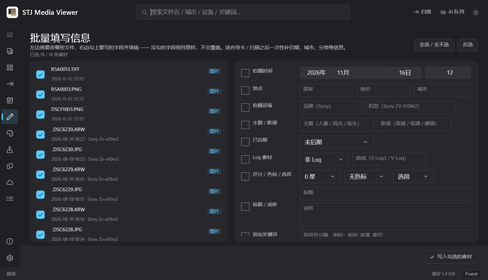

- **左侧挑文件**：列表带勾选框，显示文件名 / 拍摄时间 / 城市 / 设备；顶部「全选 / 全不选」「反选」，页头实时显示"已选 N / M 条"。
- **右侧勾字段填值**：每个字段前都有开关 —— **只有勾上的字段才会写库**，没勾的保持原样，不会把已有信息覆盖成空。
  支持：拍摄时间（日期 + 时间）、国家 / 省份 / 城市、拍摄设备（品牌 + 机型）、主题 / 影调、已后期、Log（是否 + 曲线）、评分 / 色标 / 选用、标题 / 说明、追加关键词。
- **写入前确认**：表单底部实时显示"将要写入"的摘要（例如 `拍摄时间 2024-05-18 09:30 · 城市 巴黎 · 评分 4`），确认无误再点「写入勾选的素材」。
- **两个入口**：素材库框选后点工具条「批量填写」；导入（导卡）完成后在报告区点「填写这批文件的信息」，直接带着这批素材过来。
- 语义：文本字段**留空 = 不改动**；要清空已有值就写上内容再删掉（提交空串），自检覆盖了"未勾选字段保持不变 / 空值清空 / 空 patch 不写库"三种情况。
- 实现：`IAssetStore.ApplyBatchEditAsync(ids, BatchEditPatch)` 在**单个事务**里用一条动态 UPDATE 写完所有字段（含关键词 JSON 合并），并刷新 `captured_day` / `city_source` 等派生列；写完同时失效缩略图缓存并刷新图库。

### 2.7 云同步（坚果云 / Nextcloud / 群晖 NAS / 任意挂载目录）


- **同步过滤**：自动忽略 macOS AppleDouble（`._xxx`）、`.DS_Store`、`Thumbs.db`、`@eaDir` / `#recycle` / `$RECYCLE.BIN` / `__MACOSX` 等系统索引目录、隐藏文件以及 App 自己的缓存目录；计划摘要会显示「已忽略系统文件 N 个」。
- **不预置示例目标**：云同步页初始是空的，只保留你自己创建的目标（早期版本写入的 `demo-nutstore` / `demo-nas` 示例会被自动清掉）。
- **两种接入方式**：`WebDAV`（坚果云、Nextcloud/ownCloud、群晖 DSM、威联通 QTS，自定义地址/账号/应用密码/云端子目录）与`本地挂载目录`（OneDrive、坚果云客户端目录、SMB 映射盘、已挂载 NAS）；同步路径、方向、冲突策略都可在界面里改。
- **双向 / 单向**：双向（两边互补）、仅上传（本地→云端）、仅下载（云端→本地，云端照片自动落到本地图库目录）；默认**永不删除**任何一端的文件，只补齐缺失与传输变更。
- **冲突策略**：较新者胜（默认）/ 本地优先 / 云端优先 / 两边都保留（本地另存 `xxx (本地 时间戳).jpg`、云端另存 `xxx (云端 时间戳).jpg`）。
- **先预览再执行**：差异计划（上传 x / 下载 y / 冲突 z + 逐条明细）→ 演练（dry-run，不落盘）→ 正式执行；进度条 + 逐文件失败明细。
- **自动同步**：后台按轮询间隔（默认 5 分钟）检查，本地目录变化由 `FileSystemWatcher` 5 秒抖动合并触发；同一目标不会并发跑两轮；传输后可逐文件哈希核验（本地目录目标用 SHA-256 双边比对，WebDAV 用大小 + 回列校验）。
- **凭据安全**：WebDAV 密码用 Windows DPAPI（当前用户域）加密后存 settings.json，明文不落盘。
- 实现细节：`Core/Cloud/` 里 `ICloudStorage` 把协议抹平（`WebDavCloudStorage` 用 `PROPFIND Depth:1` 逐层下钻 + Basic 认证 + 分段 URL 编码；`LocalFolderCloudStorage` 走文件系统），`CloudSyncService` 只做一次"本地索引 ↔ 云端条目"比对再分发动作，所以以后加 S3/FTP 只需再写一个适配器。

### 2.8 视频编码识别与转码 / 压缩

- **编码显示**：视频卡片与检视面板显示归一化编码（`avc1/h264/x264` → **H.264 / AVC**，`hev1/hvc1/hevc` → **H.265 / HEVC**，另有 AV1 / VP9 / ProRes / DNxHR / Dolby Vision / MPEG-4/2 等），一眼看出是否需要转码。
- **探测**：不依赖 ffprobe —— 直接解析 `ffmpeg -i` 的流信息，拿到编码、分辨率、码率、时长、帧率、位深、像素格式、HDR（HLG/PQ）、音轨、旋转。
- **内置预设**：H.265 1080p 压缩、H.264 1080p 压缩（兼容性最好）、H.265 720p 手机分享、高画质 H.264 原分辨率、**转封装（`-c copy` 不重编码，零画质损失）**、AV1 720p（最省体积）。
- **可调参数**：编码器（H.265 / H.264 / AV1 / 不重编码）、CRF 质量、目标分辨率、速度预设、硬件加速开关；输出体积按源码率/时长/CRF 估算并给出"预计减少 %"。
- **硬件加速**：启动时用 `ffmpeg -encoders` 探测本机能力，优先 `h264_nvenc` / `hevc_nvenc` / `av1_nvenc`（QSV/AMF 同理），不可用自动回落 `libx264` / `libx265` / `libsvtav1`；对话框里直接显示当前机器可用编码器。
- **执行与校验**：实时进度（已处理时长、倍速、剩余 ETA）、完成后**重新解析输出**确认编码/分辨率正确，并给出"体积从 x 到 y、减少 z%"；输出文件名自动带 `_hevc1080p` 之类的后缀，避免覆盖原件。
- **批处理**：`ITranscodeService.TranscodeManyAsync` 支持批量（进度按文件数加权），供后续"选中多个视频一起压"使用。

### 2.8.1 视频 LUT 与自动调色

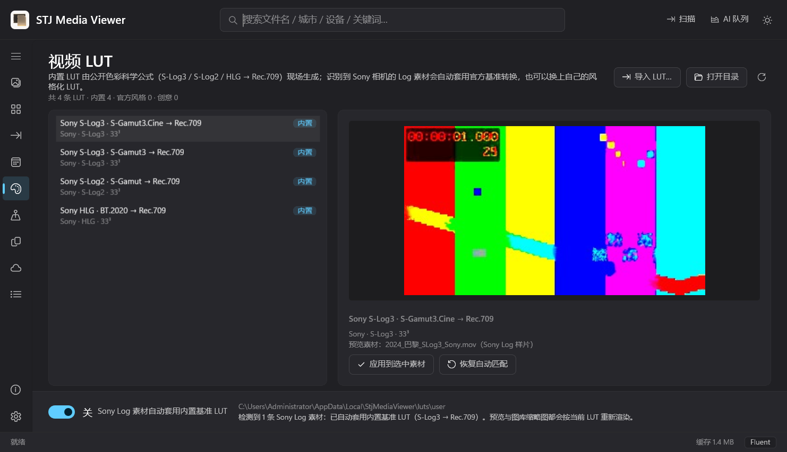

- **内置 LUT 不用打包任何厂商私有资产**：按 Sony 公开的 S-Log3 / S-Log2 白皮书与 ITU-R BT.709 / BT.2100 公式**现场生成** 33³ 的 `.cube`（首次打开自动落盘到 `%LOCALAPPDATA%\StjMediaViewer\luts\builtin`）：
  `S-Log3 · S-Gamut3.Cine → Rec.709`、`S-Log3 · S-Gamut3 → Rec.709`、`S-Log2 · S-Gamut → Rec.709`、`HLG · BT.2020 → Rec.709`。
  18% 灰校验：S-Log3 编码值 0.4105 → 输出 0.409（709 中灰附近），黑白端点不塌。
- **自动导入与匹配**：扫描到 `CameraMake/DeviceKey` 含 Sony 且 `IsLog`（S-Log2 / S-Log3 / HLG）的素材，自动套用对应内置基准 LUT —— 图库缩略图、画廊大图、LUT 页预览都会按它重新渲染。开关在 LUT 页底部（默认开）。
- **用户自己的风格化 LUT**：把 `.cube` 丢进用户目录，或点「导入 LUT…」多选导入（同名自动加序号）。文件名/目录名会被分类：`SLog3SGamut3.CineToLC-709TypeA` 这类认作**官方风格**（Sony / S-Log3），其余算**创意风格**；列表里按「内置 → 官方 → 创意」排序。
- **预览即所得**：选中任一 LUT，右侧用当前图库选中素材（没有就自动挑一条 Sony Log 样片）实时调色预览；「应用到选中素材」把选择写回索引库（`assets.lut_id`），「恢复自动匹配」清掉显式选择。
- **缓存按 LUT 分桶**：缩略图缓存键带 LUT 哈希（`..._320_lut1e38023.jpg`），切换 LUT 不会互相覆盖，也不会重复解码。
- 实现：`Core/Color/` 下 `CubeLut`（解析 + 三线性插值）、`LutApplier`（BGRA 帧调色）、`BuiltInLuts`（公式生成）、`LutCatalog`（分类 / Sony 自动匹配）、`LutService`（目录扫描、导入、预渲染）。自检 19 项覆盖生成、解析、应用、分类与自动匹配。

### 2.9 画廊视图（素材库工具条「画廊」进入）

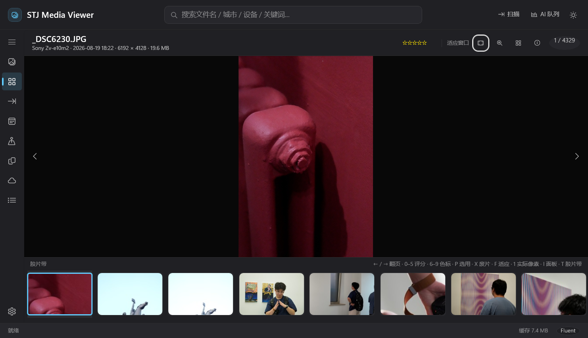

- **入口**：素材库工具条「画廊」按钮（或键盘 `G`）；顶部「← 素材库」/ Esc 返回。
- **大画布 + 底部胶片带**：上方信息条（文件名、设备、时间、真实分辨率、体积、视频编码、评分/色标/选用状态、序号），中间画布只给照片让路（深色 scrim），底部横向胶片带显示当前项强调描边、评分与编码角标。
- **缩放与平移**：滚轮以鼠标位置为锚点缩放（5%–800%）、双击在「适应窗口 / 100% 实际像素」之间切换、按住左键拖拽平移；窗口、胶片带、面板尺寸变化时自动重新适应。
- **键盘流**：左右方向键翻页、Home/End 首尾、0–5 评分（0 清除）、6–9 色标（红/黄/绿/蓝）、P 选用、X 废片、I 元数据面板、T 胶片带 —— 全程不碰鼠标。
- **复用现有能力**：数据源是素材库的**当前筛选条件**（搜索 / 分面 / 分组都继承），右侧内嵌同一个检视面板（元数据 + 手工分类 + 保存 / AI / XMP），视频可直接转码压缩，快速编辑立即落库。
- 解码只取当前一张（2400px），切换时取消上一张请求；胶片带缩略图走同一套磁盘缓存，4000+ 张的库翻页也不掉帧。

### 2.11 文件整理（按分类移动真实文件，本地 + 云端）

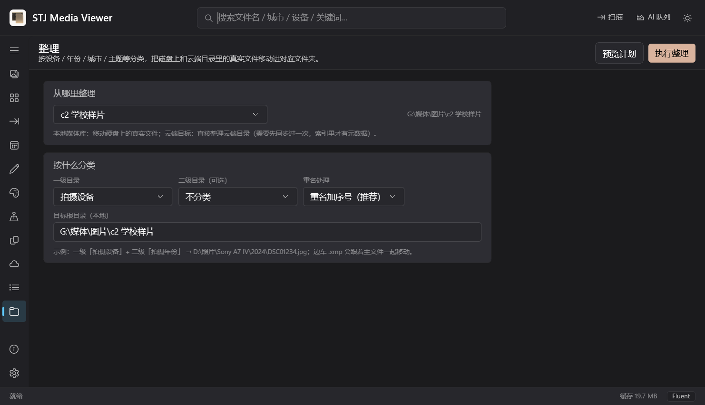

- **种类**：拍摄设备 / 相机品牌 / 年份 / 年月 / 月份 / 日期 / 城市 / 国家 / 主题 / 影调 /
  自定义类别 / 格式 / 媒体类型 / 评分 / 色标 / 扩展名；支持一级 + 二级（`设备/年份`）。
- **操作的是硬盘上的真实文件夹**：先出计划（原路径 → 目标路径、冲突、大小）→ 再执行；移动完自动更新索引库路径，
  不用重新扫描；`.xmp` 边车跟着主文件走。
- **重名策略**：默认自动加序号，也可「跳过已存在」「覆盖」。
- **云端也能整理**：选云同步目标 → 用本地索引库元数据算出目标目录 → 云端 MOVE（WebDAV `MOVE` / 本地挂载目录直接移动）；
  索引里没有元数据的云端文件会跳过并提示。
- **撤销上次整理**：每次整理都会记录移动映射，一键搬回原处（本地/云端都支持）。
- 实现：`Core/Write/OrganizerService.cs`（计划 / 执行 / 撤销）+ `Core/Cloud` 的 `ICloudStorage.MoveAsync`。

### 2.12 云同步群组协作（写入作者名）

- 同步目标勾选「群组协作」→ 填自己的用户名（必填）。
- 上传时作者名写入三处：本地素材 XMP `dc:creator`、索引库 `creator`、云端作者清单 `.stj-authors.json`
  （清单合并更新，不会覆盖其他成员写入的记录）。
- 适合多人共用一个云空间：事后能查到每个文件是谁传的。

### 2.13 素材库「来自 xx 云同步」分类

- 从云端下载回来的素材自动记录来源云同步目标名（`assets.origin`）。
- 筛选面板出现「云同步来源」分组：按某个云盘筛选，或选「本地文件」只看本地素材。

### 删了 / 移动了软件或素材文件夹后，预览图不显示

索引库里存的是**绝对路径**。如果导入过素材库之后把那个文件夹删掉、移动或改名（包括把便携版整个文件夹挪走），
素材条目还在、但文件已经不在原处，缩略图自然生成不出来。v1.5.0 起：

- 打开素材库时如果检测到库目录不存在，顶部会出现黄色提示条，写明「缩略图不会生成」和「去设置修复」；
- **设置 → 媒体库 → 「重新定位」**：选择文件夹的新位置，程序会按**相对路径**把已有素材逐一指过去，
  子目录结构保留；缩略图在下次浏览时自动重新生成；
- 新目录里确实找不到的文件会被如实计数，可用「清理失效记录」移除（只删索引，不动磁盘文件）；
- 自定义缓存目录失效（指向已删除的文件夹 / 拔掉的移动硬盘）时，自动回退默认缓存目录。

> 说明：只是**卸载/覆盖安装**不会丢媒体库；丢的是"库目录本身被删除或移动"这种情况。

### 照片 / 视频分成两个库（默认开启）

侧边栏把素材库拆成两个入口，各用不同图标：

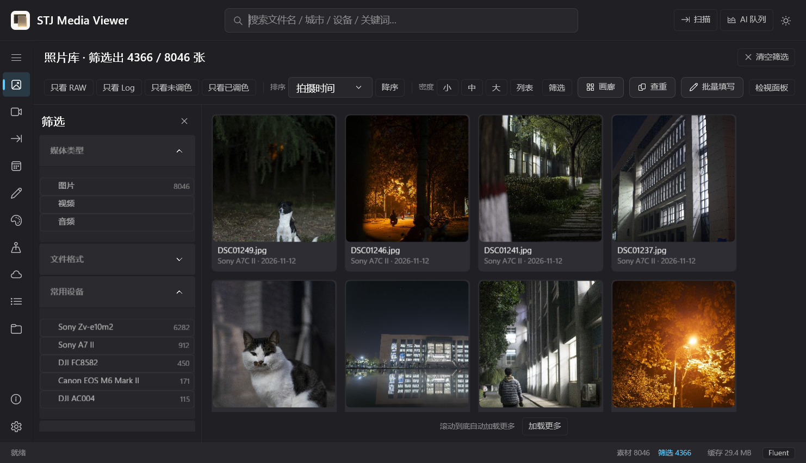

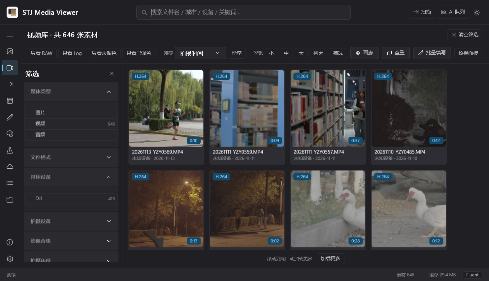

- 照片库只显示图片，视频库只显示视频/音频（分面计数、筛选都按当前库统计）；
- **导卡自动分开导入**：导入完成后按文件类型自动切到对应库，状态条写明「照片 N 张 → 照片库，视频 M 个 → 视频库」；
- 「设置 → 媒体库」可开关（默认开启），关掉回到单个「素材库」：

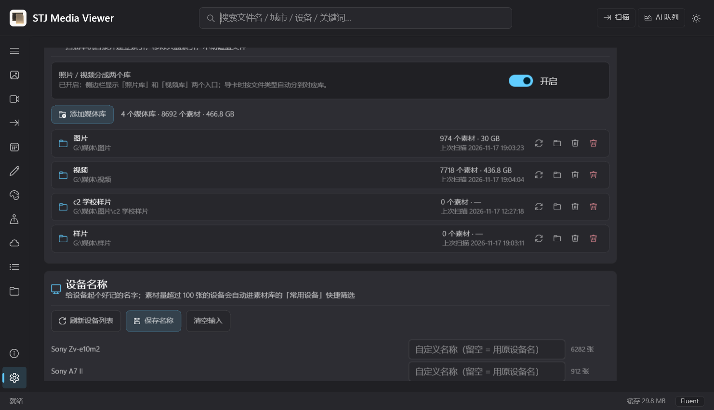

- 只是展示分层，**不动磁盘文件、不复制素材**。

### 设备 ↔ LUT 绑定（Log 素材自动监视）

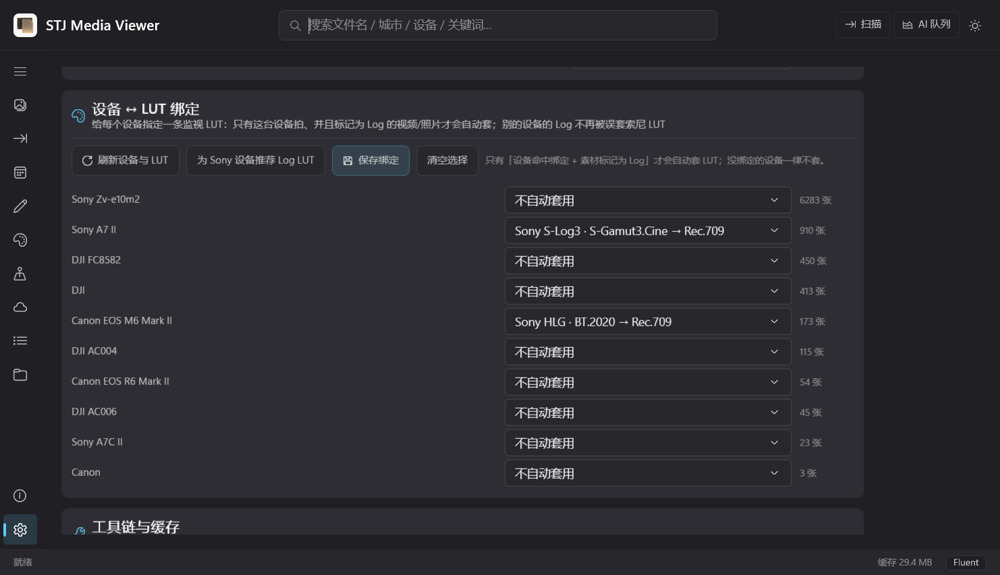

- 在「设置 → 设备 ↔ LUT 绑定」给每台设备指定一条监视 LUT；
- **只有「设备命中绑定 + 素材标记为 Log」才自动套**；没绑定的设备（哪怕它是 Log）不套，
  所以别的设备拍的 Log 素材不会再被误套 Sony LUT；
- 「为 Sony 设备推荐 Log LUT」一键预填内置 S-Log3 → Rec.709（其他品牌导入官方 .cube 后手动选）；
- 图片 / 缩略图按绑定 LUT 重新渲染；
- **视频**：Log 视频会用 ffmpeg 把 LUT 烧进预览代理再播放，状态条会写明套了哪条、按哪台设备:

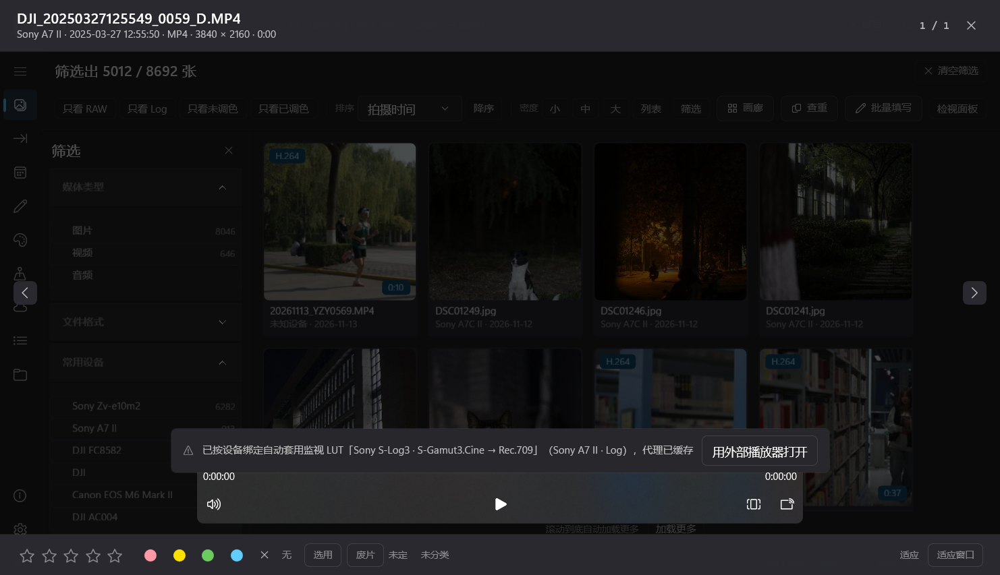

### 合并为大文件夹（多重曝光 / 星轨 / 演示视频）

选中 2 张以上素材 → 工具条「合并」（或右键「合并所选为一个大文件夹…」）：

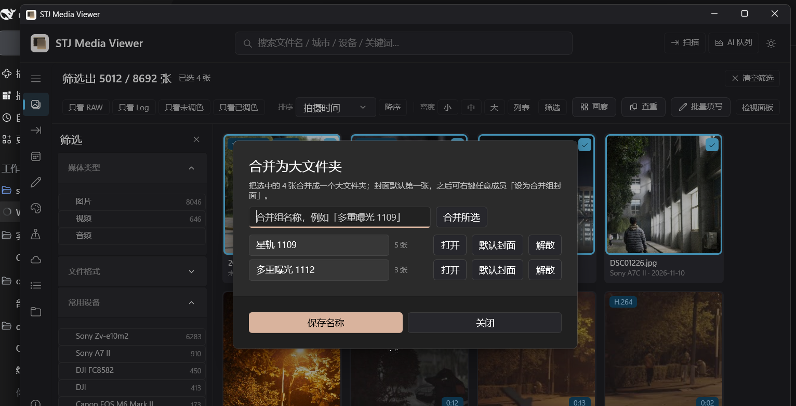

- 素材库里只占一张卡片，角标「**合并 · N 张**」，**封面默认组内第一张**；
- 右键组内成员 →「设为合并组封面」自定义封面，对话框里可「默认封面」还原；
- 双击合并组卡片 → 筛选到组内成员逐张查看；
- 右键「解散合并组」只解散归类，**素材文件不动**；
- 筛选面板新增「合并组」分组，可多选（并集）。

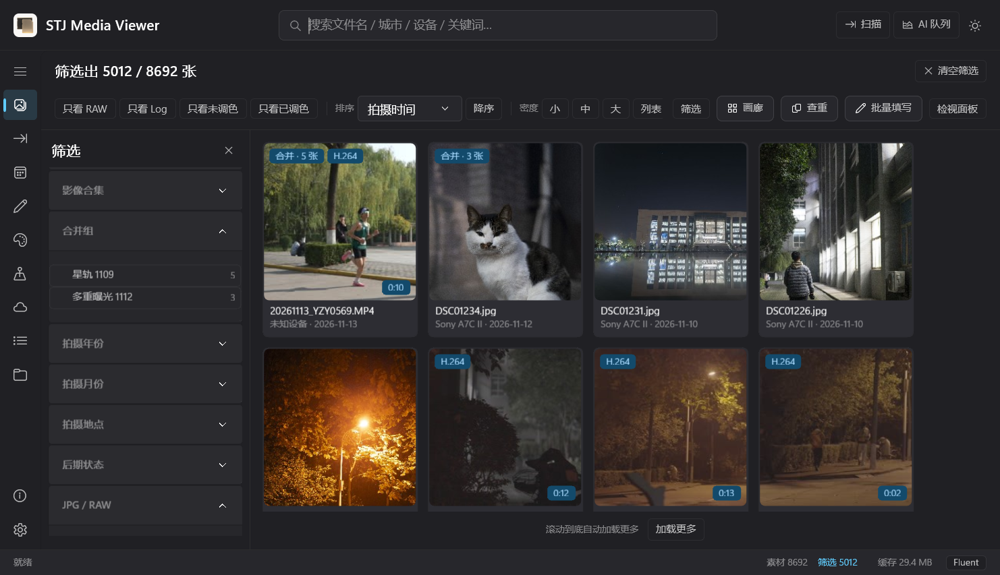

### 合并组：封面折叠 + 返回上一步

合并之后组内素材折叠成一张封面卡片，点开才展开；展开后顶部有「返回」恢复上一步视图（筛选 + 滚动位置）。

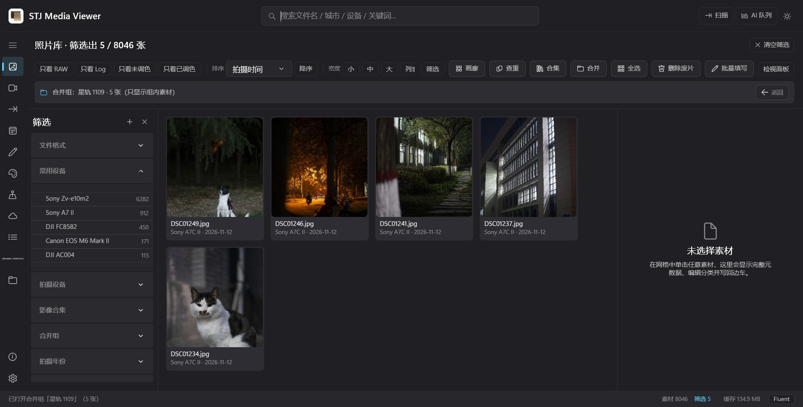

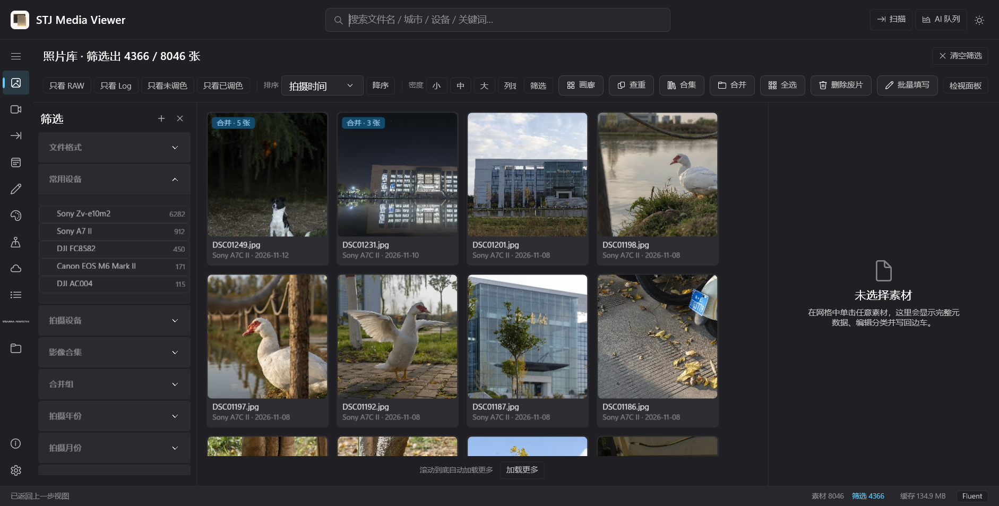

### 影像合集（自建素材分组）

素材库工具条点「**合集**」，可以新建 / 重命名 / 删除合集；选中素材后直接「加入所选 / 移出所选」。
右键素材也有「加入影像合集…」。

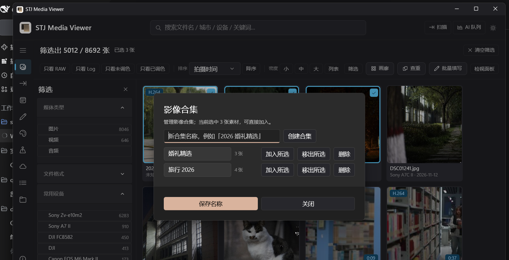

筛选面板新增「影像合集」分组：多选是并集，还有「未加入合集」用来找没归档的素材。

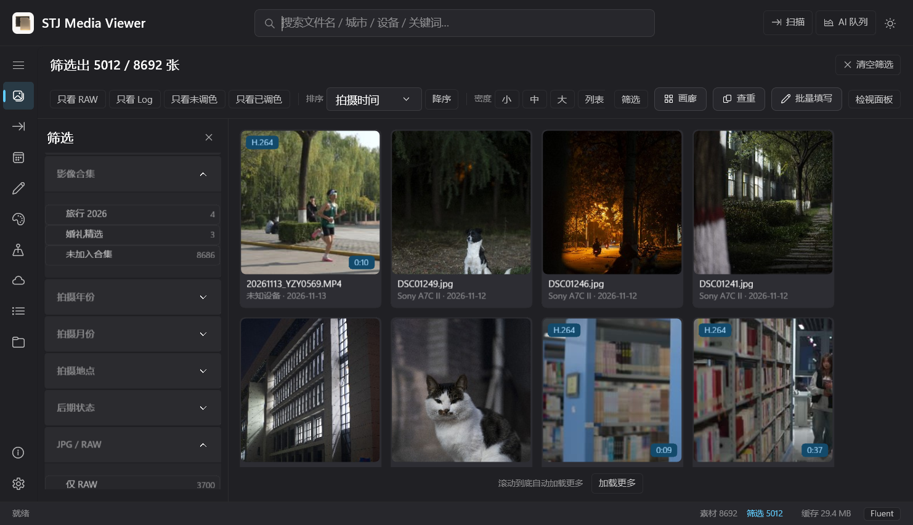

- 多对多：一张素材可以进多个合集；**不动文件**，只记关系；
- 删除合集只删归类，素材不受影响；
- 索引库自动建表，旧库打开即用。

### 预览编辑：旋转 / 翻转 / 缩放

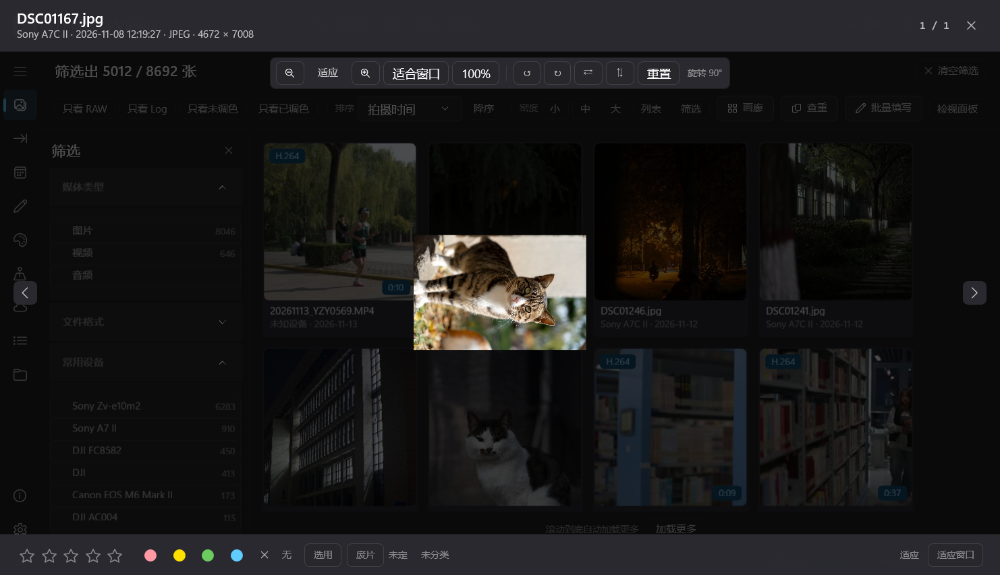

预览顶部有编辑工具条：

- **缩放**：− / 百分比 / + / 适合窗口 / 100%；滚轮缩放、拖拽平移、双击 1:1 仍在；
- **旋转**：↺ 逆转、↻ 顺转，转完自动适合窗口；
- **翻转**：⇄ 水平、⇅ 垂直；「重置」一键还原；
- 快捷键：`R` / `Shift+R` / `F` / `V` / `0` / `1` / `+` / `-`。

编辑会写进索引库，**网格缩略图也会按编辑后的方向重新生成**：

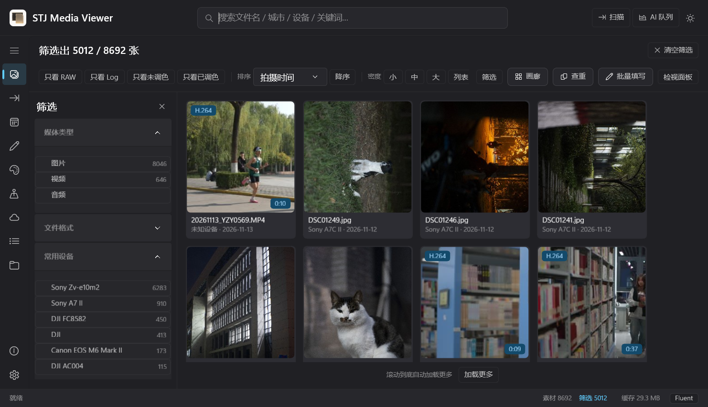

### 框选 + 可点选项的边框

**框选**：在素材库网格的空白处/卡片缝隙按住左键拖出一个选择框，框到的卡片实时选中（Explorer 手感），
`Ctrl` + 框选可叠加；拖到边缘自动滚动。

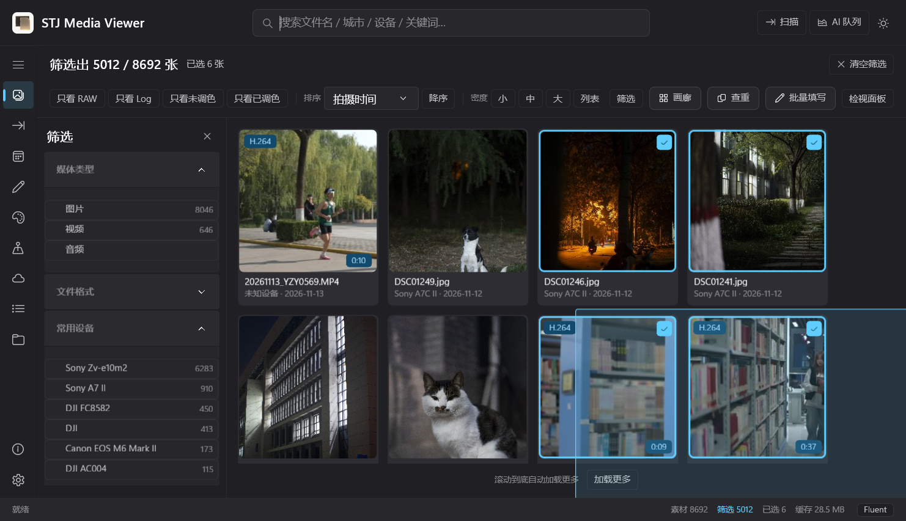

**所有可点选项都有圆角矩形边框**：工具条里的「只看 RAW / 只看未调色 / 密度 / 筛选 / 画廊…」、
筛选面板每一行、顶栏「扫描 / AI 队列」，静止态一圈淡边框、选中态强调色描边 + 强调色文字，
点没点中一眼能看出来。


### 自定义设备名 + 常用设备

**给设备起名**：设置 → 设备名称，把 `Sony Zv-e10m2` 改成 `ZV-E10 II（我的自拍机）`、`DJI` 改成 `无人机`。
素材卡片、检视面板、筛选面板和「整理」分目录都会用新名字；留空就用原设备名。

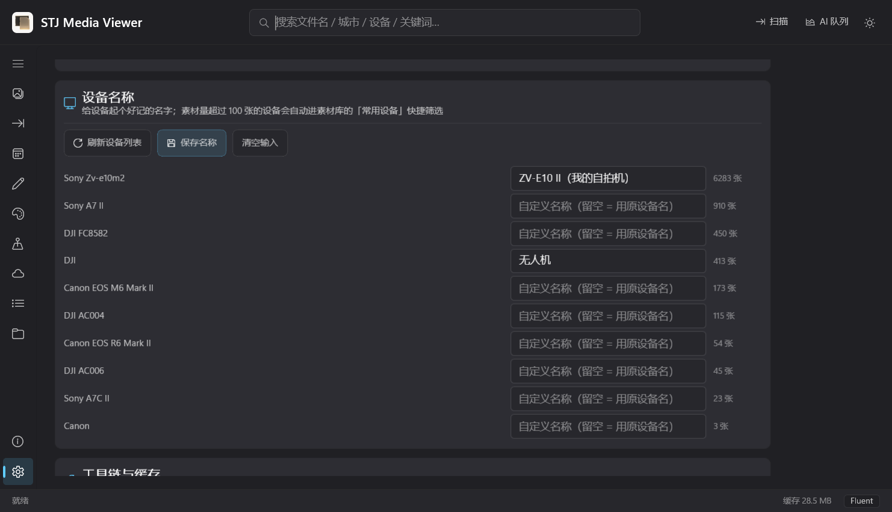

**常用设备快捷筛选**：素材库 → 筛选 → 「常用设备」，自动列出**素材量超过 100 张**的设备（按数量降序），
点一下即可只看这台机器拍的片子；名称同样用自定义名称。


### 视频报「无法解码」：相机 4:2:2 / 10-bit / HEVC 用 ffmpeg 代理播放

相机原片常见 **H.264 High 4:2:2 10-bit**（Sony XAVC、部分无人机/监视器录制）或 **HEVC 10-bit**，
Windows 自带解码器**不支持**这些格式，播放器会直接报「错误：无法解码视频」——这不是文件坏了。

v1.6.1 起：

- 检测到播放失败时，自动用 ffmpeg 转一份 **H.264 8-bit 4:2:0 · 720p** 的预览代理再播，
  第一次转码稍等几秒，之后同一文件秒开（代理缓存在 `%LOCALAPPDATA%\StjMediaViewer\Cache\proxy`）；
- 播放器下方显示「已用 ffmpeg 预览代理播放（H.264 8-bit · 720p，代理已缓存）」；
- 没配置 ffmpeg 会提示去「设置 → 工具链」指定 ffmpeg.exe；
- 也可以点「用外部播放器打开」交给系统播放器（装了 HEVC 扩展之类的环境可能直接能播）。

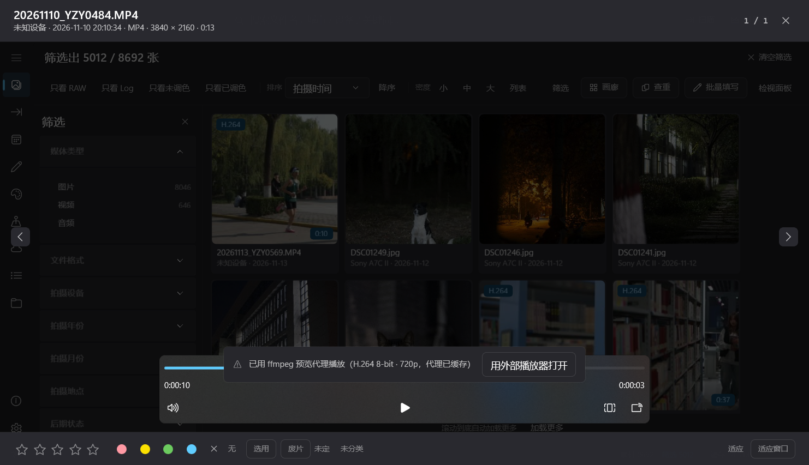

### 多主题（一张图属于多个主题）

检视面板的「主题」现在是**多选**：一张「夜景里的城市建筑」可以同时勾上 自然 / 城市 / 夜景 / 建筑。

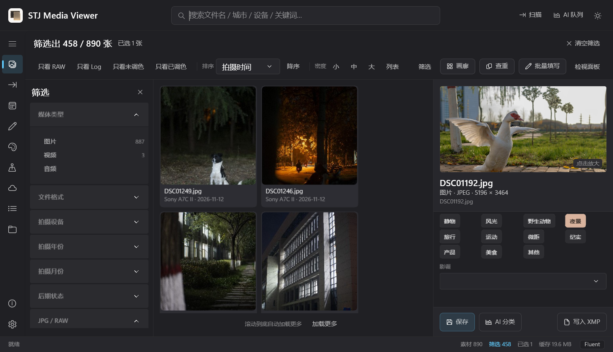

- **第一个选中的主题是主主题**（用于整理分文件夹、以及旧逻辑里的单值主题）；
  上面的下拉仍可快速指定主主题（会重置为单选）；
- 素材库左侧「拍摄主题」筛选和分面计数按**全部主题**统计：勾「夜景」能筛出主主题是「自然」的照片；
- 多选素材时改主题，会一次性写入全部选中素材；
- AI 分类给出的主题作为主主题，人工加过的其它主题保留；
- 「整理」的主题维度按主主题分文件夹（一张图不会进多个目录）；
- 数据库自动加 `themes_json` 列并回填旧数据，无需迁移操作。

### 云同步连不上 / 传不上去：先点「连接诊断」

v1.5.1 起每个同步目标卡片都有「**连接诊断**」按钮，会逐步检查并显示结果：

```
✓ 创建连接        [2ms]   WebDAV · http://… · 本地 D:/…
✓ 连通性 / 鉴权   [39ms]  服务器有响应，账号可用
✓ 列出云端目录    [51ms]  0 个文件
✓ 上传测试文件    [8ms]   4 B → .stj-connect-test-125050.txt
✓ 确认文件已上传  [4ms]   已确认（2 B）
✓ 清理测试文件    [2ms]   已删除探针文件
连接正常（6 项全部通过，用时 106ms）
日志：C:\Users\…\stj-media-viewer.log
```

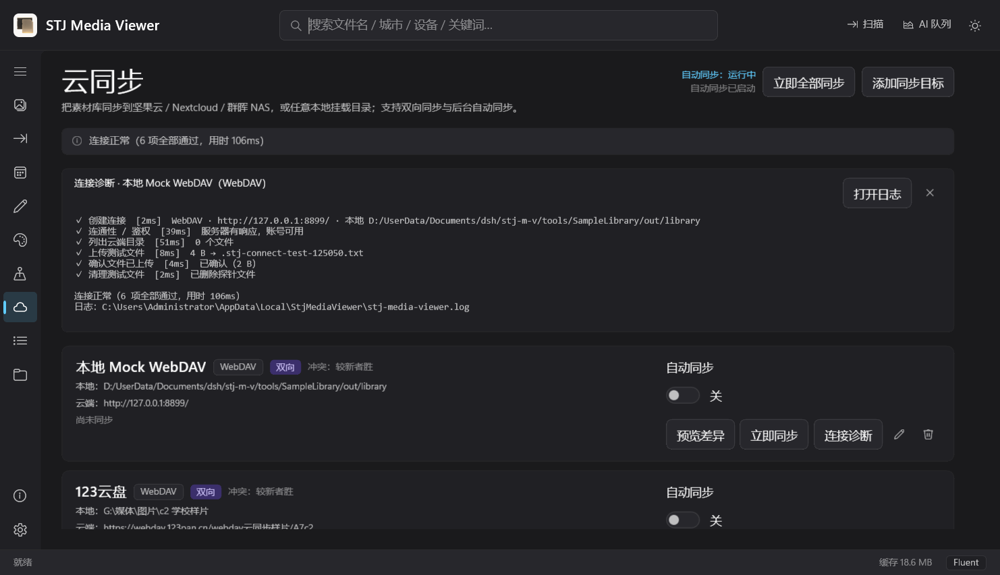

- 哪一步 ✗ 就是问题所在：鉴权失败 → 账号/应用密码；列目录失败 → 路径或权限；上传失败 → 服务器限流/单文件大小限制；
- 所有 WebDAV 请求都会写进日志（`[webdav] GET/PUT/PROPFIND … → 状态码 耗时 字节数`），失败带异常消息；
- 面板里的「打开日志」直接打开日志文件，方便对照。

### 云同步上传失败（远程主机强迫关闭了一个现有的连接）

坚果云等 WebDAV 服务器对短时间大量上传有限流：一次性同步几十张照片时，服务器会直接断连，
表现就是「照片传不上去，但很小的 XMP 边车却能传」。v1.4.1 起已自动处理：

- 上传/下载遇到断连自动退避重试（最多 3 次，间隔 1.2s / 3.5s）；
- 每次上传成功后有节奏间隔（WebDAV 120ms，坚果云 350ms）；
- 手动同步与后台自动同步不会并发（同一账号两个会话会被服务器踢）；
- 单请求超时放宽到 600 秒，大文件慢速上行不会被打断；
- 失败后再次点「立即全部同步」即可，已成功的文件不会重传。

如果重试 3 次仍全部失败：先确认坚果云的**每月上传流量 / 单文件大小限制**没触发，
再检查网络（代理/VPN 也可能导致连接被重置）。

### 2.15 按细分位置分类（GPS 范围内算一个文件夹）

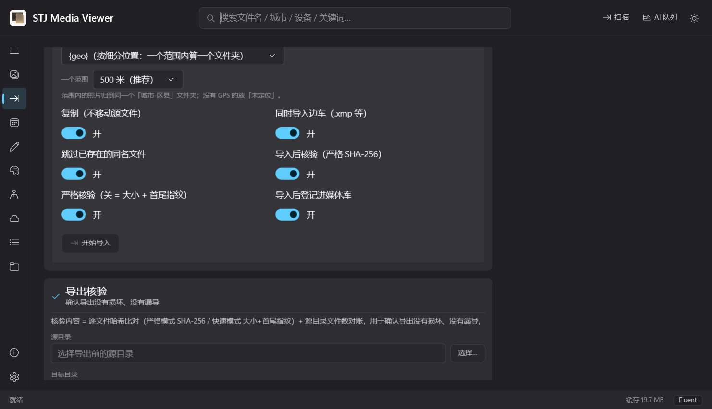

导卡（导入）的子目录模板新增 **`{geo}`**：按拍摄地 GPS 聚类，**一个范围内**（默认 500 米）的照片
归到同一个文件夹：

- 目录名优先用离线城市库反查的「**城市-区县**」（如 `上海-黄浦区`、`杭州-西湖区`）；
  城市库不可用/查不到时用坐标兜底（如 `31.231_121.474`，保留 3 位小数约 100 米精度）；
- 范围可选 **200 米 / 500 米（默认）/ 1 公里 / 2 公里 / 5 公里**；
- 模板可组合：`{geo}` 或 `{yyyy}/{geo}`；
- 没有 GPS 的照片进「**未定位**」文件夹，不会丢；
- 只有选了 `{geo}` 才读 GPS，普通导卡不受影响。

「整理」页也加了同名维度 **「细分位置」**，与导卡共用同一套聚类，可单独用，也可作为二级目录
（例如 `设备/细分位置`），同样支持 200 米 ~ 5 公里与「未定位」。

实现：`Core/Import/GeoClusterer.cs`（Haversine 距离 + 贪心聚类 + 同名去重），
导卡走 `ImportService` 的模板展开，整理走 `OrganizerService` 的维度计算。

### 2.14 自定义缓存路径与自动清理

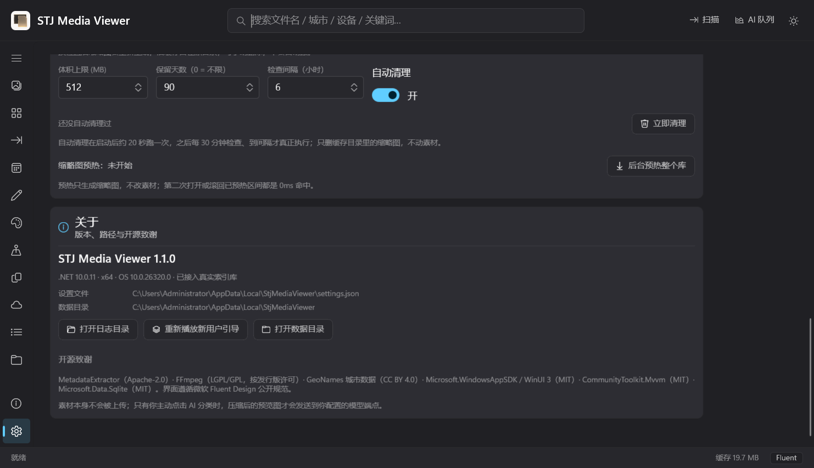

**缓存位置**

- 默认 `%LOCALAPPDATA%\StjMediaViewer\Cache`（缩略图在 `thumbs` 子目录）；
- 设置 → 工具链与缓存 → 「缓存位置」可以指到任意盘（大容量 SSD / 移动硬盘都行），带「浏览…」和「恢复默认」；
- 改完**即时生效**：热切换缩略图服务、内存加载器与预热器，不用重启；旧缓存留在旧目录，不会自动搬或删。

**自动清理**

| 选项 | 说明 |
| --- | --- |
| 体积上限 | 缓存目录超过该体积就从最旧的文件开始删（64 MB – 64 GB） |
| 保留天数 | 超过天数的缓存文件直接删（0 = 不限） |
| 检查间隔 | 自动清理的最小间隔（小时），默认 6 |
| 自动清理 | 总开关；关掉后只有手动「立即清理」才清 |

执行时机：启动后约 20 秒第一次（错开首屏解码高峰），之后每 30 分钟检查、到间隔才真正执行。
只删缓存目录里的缩略图，不动任何素材；设置页有「立即清理」按钮和上次清理结果。

### 2.10 关于页

品牌署名 **Stjarna PERSPECTIVE 出品 / co-worked with DeepSeek Harness**，含 logo、版本与环境信息（.NET / Windows 版本 / 构建日期）、技术栈与第三方许可清单，以及四张项目表情包（随仓库分发）。

### 2.11 界面

- 微软 Fluent 设计语言：Mica 窗口背板、Segoe UI Variable 字阶、细描边、键盘友好的焦点视觉；标准控件（NavigationView / TextBox / ComboBox / Button…）由 ~140 个框架资源键统一覆盖。
- 明暗模式：跟随系统 / 浅色 / 深色，切换只重解析 token，不重建界面。
- 全部界面只用语义 token（`{ThemeResource ...}`），页面里没有一处硬编码颜色/字号/圆角。

### 2.9.1 应用图标

<p align="center">
  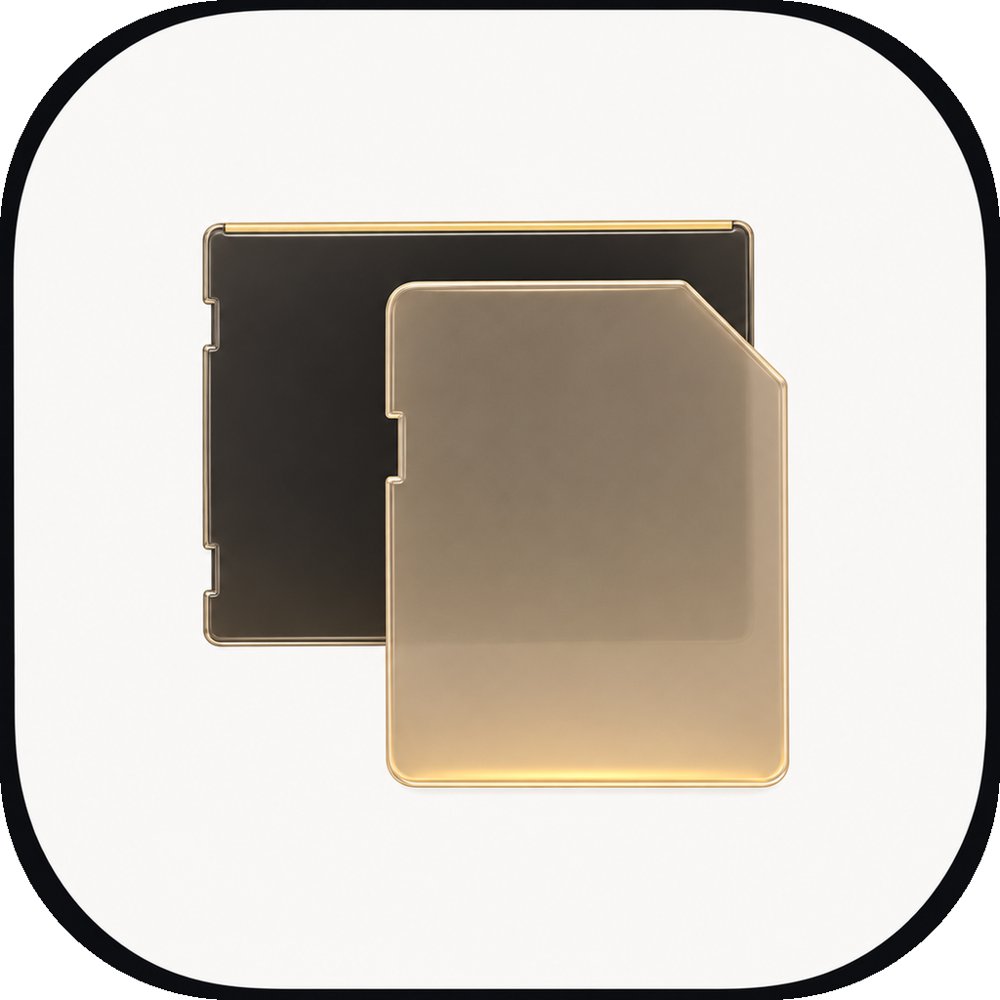
  &nbsp;&nbsp;
  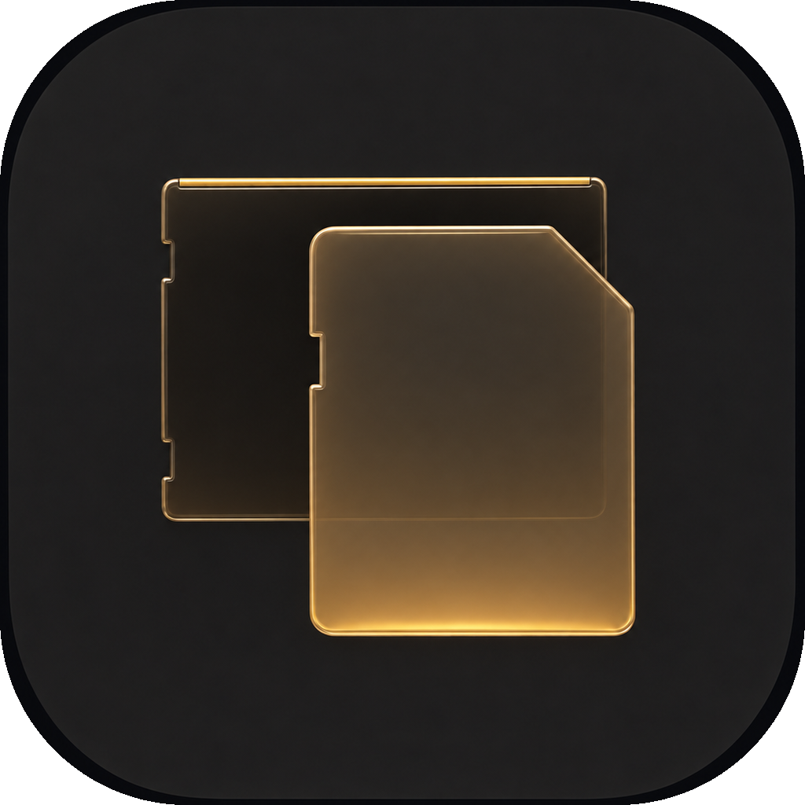
</p>

品牌图标：**SD + CF 卡**（金色线稿，亮/暗两版）。资源在 `src/StjMediaViewer.App/Assets/AppIcon/`：

| 文件 | 用途 |
| --- | --- |
| `icon-light.png` / `icon-dark.png` | 原始方图（白底 / 深底），用于关于页等大尺寸展示 |
| `icon-light-compact.png` / `icon-dark-compact.png` | 紧凑版（图形放大 7%），标题栏 28px 等小尺寸更清楚 |
| `app.ico` | 多尺寸 ICO（16–256），exe 图标 + 任务栏 + 窗口图标 |

接线：`<ApplicationIcon>Assets\AppIcon\app.ico</ApplicationIcon>` 决定 exe 图标；`MainWindow` 里 `AppWindow.SetIcon()` 保证窗口/任务栏图标；标题栏品牌位与关于页用紧凑版 PNG。

### 2.10 崩溃诊断（0xC000027B / 闪退）

WinUI 的 **stowed exception**（退出码 `0xC000027B`）不会走 `UnhandledException`，日志里看不到"未处理异常"。为此内置三层留痕：

1. `AppDomain.FirstChanceException`：记录每次"首次异常"的完整堆栈（自动过滤取消异常、以及 WinUI 探测 `ApplicationData.Current` 的正常噪声）；
2. `AppDomain.UnhandledException` / `TaskScheduler.UnobservedTaskException`：后台线程的致命异常先写日志再终止；
3. 日志：`%LOCALAPPDATA%\StjMediaViewer\stj-media-viewer.log`。

已知并已修复的一类：缩略图曾经用 `InMemoryRandomAccessStream` + `BitmapImage.SetSourceAsync` 后立刻 `Dispose()` 流。`SetSourceAsync` 返回时解码尚未结束，渲染线程随后读到已释放的流 → 原生崩溃（只在视频这种"冷缓存 + 多路并发"场景触发）。现在统一**按磁盘缓存文件的 URI 加载**，缓存文件做 SOI/EOI 完整性校验（半截 JPEG 直接删除重生成），Shell 缩略图调用串行化。

复现脚本：`tools/diagnostics/repro-video-crash-click.ps1`（UI 自动化真点一次"视频"筛选）、`tools/diagnostics/stress-grid-scroll.ps1`（清空缩略图缓存 + 滚动网格压测）。

## 3. 快速开始

```powershell
# 环境：Windows 10 1809+ / Windows 11，.NET 10 SDK
git clone <repo> ; cd stj-m-v

# 1) 编译
dotnet build src/StjMediaViewer.App/StjMediaViewer.App.csproj

# 2) 运行（免安装运行时，self-contained）
.\src\StjMediaViewer.App\bin\Debug\net10.0-windows10.0.19041.0\win-x64\StjMediaViewer.exe
```

首次启动点顶部「扫描」→ 选一个素材文件夹。想先用测试数据体验：

```powershell
# 生成 85 个文件的真实测试素材库（含 EXIF/XMP/RAW/真实 H.264 视频/音频/反例/重复）
python tools/SampleLibrary/generate.py
# 把它扫进 App 的索引库
.\tools\Seed\bin\Debug\net10.0-windows10.0.19041.0\win-x64\StjMediaViewer.Seed.exe
```

ffmpeg 是可选的：把 `ffmpeg.exe` 放到 `tools/ffmpeg/bin/`（或 PATH）即可获得视频抽帧/代理转码；没有则降级到系统缩略图，不报错。

## 3.1 缩略图为什么"慢"、做了什么优化

浏览时的缩略图分两条路径，代价差 100 倍：

| 路径 | 耗时（实测，24MP JPEG） | 说明 |
| --- | --- | --- |
| **磁盘缓存命中** | **0 ms**（一次 `File.Exists`）+ BitmapImage 解 360px JPEG | 打开软件、回看已浏览过的区域都是这条 |
| **首次生成** | **≈140 ms/张**（中位 150 ms，P90 ≈ 180 ms） | WIC 解 2400 万像素原图 → 缩放 360px → 压 JPEG → 落盘 |

视频缩略图还要先 ffmpeg 抽帧（≈150–300 ms/张），RAW 走内嵌预览（通常更快）。

优化（都在 `Core/Media/MediaDecoder.cs` + `App/Services/ThumbnailLoader.cs`）：

1. **优先用内嵌 EXIF 预览**：相机/手机 JPEG 里通常塞了 1024–2048px 的预览图，解它比解原图快一个数量级（大预览的机型 140ms → ≈15ms）；预览太小则自动退回原图。
2. **缩略图用 Linear 插值 + 跳过 ICC 色彩管理**：Fant 在大倍率降采样时慢 2–4 倍，360px 上肉眼无差。
3. **并发按 CPU 数放大**：`clamp(CPU×1.5, 6, 16)`（原来固定 6），一屏 12 张不再排好几轮。
4. **预取下一批（180 张）**：页面数据加载完后在后台低并发（2）把缩略图生成并落盘，滚动时直接命中缓存。
5. **缓存按素材 + LUT 分桶**，切换 LUT 不互相覆盖；缓存文件做 SOI/EOI 完整性校验，坏文件自动删掉重生成。

### 3.1.1 后台全库预热（设置 → 工具链与缓存）

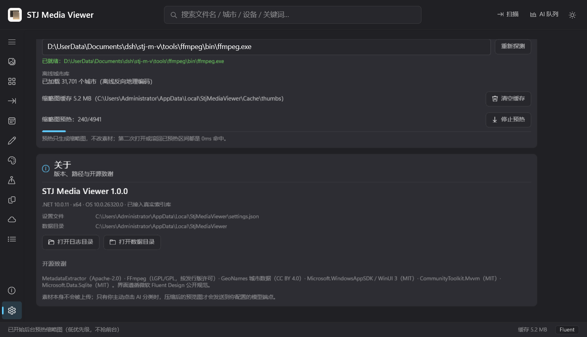

- **一键把整库缩略图生成完**：设置页「工具链与缓存」里的「后台预热整个库」。默认以**并发 2** 跑，故意压低优先级，不跟前台浏览抢 CPU / 磁盘。
- 预热范围 = **默认视图可见的素材**（JPG+RAW 折叠后每组一张，约 4900 条而不是 8611 个文件）；有 LUT 的视频会连"套 LUT 后的缩略图"一起生成。
- **可随时停止**：按钮变成「停止预热」，停了进度保留；再点「继续预热」会跳过已生成的（缓存命中 0ms），只补剩下的。
- 进度实时显示在按钮左边：`缩略图预热：240/4941` + 细进度条；完成时状态栏提示「缩略图预热完成：N 张已就绪」。
- 实测吞吐：并发 2 时约 **30 张/秒**，整库 ≈ 2–3 分钟；跑完之后全库滚动都是命中路径。
- 实现：`Core/Media/ThumbnailWarmup.cs`（只用 Core 的三个接口：`IAssetStore` / `IThumbnailService` / `ILutService`），可自检；UI 侧只负责按钮与进度。

想现场量化：设 `STJ_TRACE_THUMB=1` 启动，日志里会有 `[thumb] gen/hit/path-hit` 每张的耗时；`STJ_TRACE_DECODE=1` 还能看到 WIC 分段耗时。

## 3.2 安装包与便携版

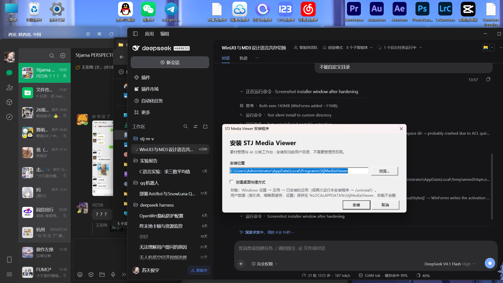

两个交付物（`dist/`，`tools/Installer/build-installer.ps1` 一键重出）：

| 产物 | 大小 | 说明 |
| --- | --- | --- |
| `STJMediaViewer-Setup.exe` | ≈143 MB | **安装包**，带图形界面：可**自定义安装目录**、可选创建桌面快捷方式；装到用户目录，不需要管理员权限 |
| `STJMediaViewer-1.17.2-portable.exe` | ≈143 MB | **便携版**：单文件，双击后解压到 `%LOCALAPPDATA%\StjMediaViewerPortable` 并直接启动；不写注册表、不建快捷方式 |

> 旧的 `*-portable-win-x64.zip` 已废弃：压缩包里的 exe 直接双击容易踩「没解压就在压缩包里运行 / SmartScreen 拦截」，
> 现在改成**单文件便携 exe**，双击即用。

**安装界面**（双击 `Setup.exe`）：

- 「安装位置」默认 `%LOCALAPPDATA%\Programs\StjMediaViewer`，可手改或点「浏览…」选任意目录；选自定义目录（如 `D:\Apps`）时安装包会**先建自己的子目录** `D:\Apps\STJ Media Viewer`，界面会实时显示最终路径；
- 「创建桌面快捷方式」可选（默认不勾），开始菜单快捷方式总会创建；
- 目录非空时二次确认；安装前自动结束正在运行的旧实例。

**权限策略（默认不需要管理员）**：

| 场景 | 行为 |
| --- | --- |
| 装到用户目录（默认） | **不需要 UAC**，双击即装 |
| 选到 `C:\Program Files` 等受保护目录 | 安装前**自动弹出 UAC** 请求提权；提权后写「所有用户」开始菜单快捷方式 + HKLM 卸载项 |
| 静默安装 `/S` 到受保护目录 | 同样自动请求提权（UAC 确认一次） |
| 不需要提权却失败了 | 不会硬报错，日志会写清原因（安装包同目录 `stj-setup.log`） |

> 安装器清单是 `asInvoker`：**不会强制**以管理员运行；只有在目标目录确实不可写时才请求提升。
> 如果你之前遇到"必须以管理员身份才能装"，那是旧版本在某些机器的 `%LOCALAPPDATA%\Programs`
> 被策略锁定/重定向时直接写失败 —— 现在会自动走 UAC，不需要你手动右键「以管理员身份运行」。

**命令行（可脚本化）**：

```
STJMediaViewer-Setup.exe                      交互式安装（选目录）
STJMediaViewer-Setup.exe /S                   静默安装到默认目录
STJMediaViewer-Setup.exe /S /D=D:\Apps\STJ  静默安装到指定目录
STJMediaViewer-Setup.exe /uninstall           卸载（/S 静默；/D= 指定安装目录）
STJMediaViewer-1.17.2-portable.exe            便携版：解压 + 启动
STJMediaViewer-1.17.2-portable.exe /D=D:\STJ 便携版解压到指定目录
```

**卸载**：Windows 设置 → 应用 → 已安装的应用（或 `Setup.exe /uninstall`）。
只删程序文件，**索引库 / 缩略图缓存 / 设置保留在** `%LOCALAPPDATA%\StjMediaViewer`（卸载提示里会说明）。

**首次启动被拦？** 未签名 exe 可能被 SmartScreen 提示：点「更多信息 → 仍要运行」，
或右键 exe → 属性 → 勾选「解除锁定」后确定。企业环境请让 IT 放行。

**技术要点**：

- WinUI 3 `dotnet publish` 不会自动带走根目录的 `App.xbf` / `MainWindow.xbf`，缺了发布版启动即崩（`0xC00000FD`）→ csproj 里 `CopyXbfToPublish` 目标补齐；
- 安装器自研单文件 exe（内嵌 zip 载荷）：WinForms 选目录界面 + `IShellLink` 快捷方式 + HKCU 卸载项，全程无管理员权限；
- 受限环境里 `EnableVisualStyles` 可能因临时目录不可写而失败 → 自动降级（界面无主题样式但功能正常）；
- 快捷方式 / 卸载项写入失败不影响安装完成，只记日志（安装包同目录 `stj-setup.log`）；
- 发布只保留 `zh-Hans` / `en` 框架资源，日期选择器等系统控件保持中文。

## 3.3 macOS 版（SwiftUI 原生）

Windows 主版本用 WinUI 3；macOS 版是独立的 SwiftUI 原生应用，见 [`macos/README.md`](macos/README.md)。

- **当前阶段 P1 = 只读素材库浏览器**：读同一份 `catalog.db` + 缩略图缓存，原生三栏界面、
  筛选/搜索/排序、检视面板、拖出到其他软件；不做写库与导入（P2–P5 见路线图）。
- **产物是 `.dmg`**，但**必须在 macOS 上构建**（Windows 无法编译出 Mach-O / 无法签名）：
  ```bash
  bash macos/scripts/build-dmg.sh          # 产出 macos/dist/STJMediaViewer-1.0.0-macos-arm64-x86_64.dmg
  ```
  没有 Mac 就走 GitHub Actions：`.github/workflows/macos-dmg.yml`（`macos-14` runner），
  push 后到 Actions 下载 `STJMediaViewer-macos-dmg` 构件。
- 签名/公证：设置 `CODESIGN_IDENTITY` + `NOTARY_PROFILE` 后脚本自动 codesign + notarytool + staple；
  不设置则 ad-hoc 签名（用户首次打开需右键 → 打开）。
- 可行性盘点与取舍（Core 可复用 ~90%、三条路线对比）见 [`docs/macos-port.md`](docs/macos-port.md)。


## 4. 工程与验证

```
src/StjMediaViewer.Core    # 无 UI 依赖：模型/契约/元数据/索引/扫描/解码/AI/地理/设置
src/StjMediaViewer.App     # WinUI 3：Views / ViewModels / Themes / Controls / Services
tools/SelfCheck            # 端到端自检（扫描→元数据→分类→查询→缩略图→去重→AI→导出→性能）
tools/SampleLibrary        # 测试素材库生成器（Python，幂等）
tools/MockAiServer         # 本地 OpenAI 兼容 mock 服务器（纯标准库）
tools/Seed                 # 把素材库扫进索引（命令行）
tools/MetaSmoke / MediaSmoke / dev
```

**验证结果**（本机 Windows 11 / .NET 10 / 85 文件样本库）：

| 指标 | 结果 |
|---|---|
| 端到端自检 | **69 项检查全部通过 / 0 失败**；其中 manifest 逐字段断言 **618/618 全过** |
| 真实 HTTP AI 链路 | 用本地 MockAiServer 实测：连接测试 / 单张分类 / 确定性 / 批量写回 全通过 |
| 59 个媒体文件全链路扫描 | 1 线程 308ms，8 线程 38ms（结果逐字段一致） |
| 单文件元数据解析 | 平均 3.3ms（稳态 <5ms），60MB RAW 预览提取 12ms |
| 1 万条素材入库 | 1.24–1.43s（约 7000 条/秒） |
| 筛选查询 | 2–10ms；分面统计 13–17ms |
| 缩略图 | 4678 张/分钟（目标 200/分钟），缓存命中 <1ms |
| 重复检测 | 58 条素材 319ms，精确 3 组 + 近重复 2 组 |
| 离线地理编码 | 31,701 城市 / 加载 48ms / 8 个 manifest 坐标全部命中 |

```powershell
# 自检
dotnet build tools/SelfCheck/StjMediaViewer.SelfCheck.csproj
.\tools\SelfCheck\bin\Debug\net10.0-windows10.0.19041.0\win-x64\StjMediaViewer.SelfCheck.exe
```

## 5. 设计系统（Fluent）

界面只认**语义 token**，不认具体颜色值：

- `App/Themes/Tokens.Base.xaml` 定义全量键（颜色/圆角/字号/动效/控件尺寸）作为兜底与契约。
- `App/Themes/Tokens.Fluent.xaml` 用**同名键**覆盖成 Fluent 取值，另含 ~140 个 WinUI 框架资源键（`NavigationView*`、`TextControl*`、`ComboBox*`、`Button*`…），所以标准控件也跟着 token 走；Light / Dark 两套 `ThemeDictionaries` 让明暗切换只重解析、不重建界面。
- 早期版本尝试过 Material Design 3 与 Liquid Glass 皮肤，因观感不达标已下线（词典文件与切换入口都已删除，`DesignLanguageIds` 会把旧的 `"md3"/"glass"` 配置安全回落到 Fluent）。

细节见 [docs/THEME-TOKENS.md](docs/THEME-TOKENS.md) 与 [docs/ARCHITECTURE.md](docs/ARCHITECTURE.md)。

## 6. 已知限制

- 暂未深度解析：AVI / MXF / BRAW / R3D / CRM / INSV / MPEG-TS（只给扩展名 + warning）；PSB 不做图层解析。
- 真实相机 HEIC 的 EXIF/XMP 若在 `iloc` 引用的 item 里，走特征扫描兜底（限 64MB）。
- 城市反查用离线 GeoNames cities15000（31,701 城市，含中文名）：极少数坐标会落到邻近区县；非中国城市的 `Province` 仍是 admin1 代码。
- 视频色彩字段用可读名（`HLG` / `S-Log3` / `BT.709`），与 ffprobe 的 `arib-std-b67` 之类原始枚举名不同（仅命名口径差异）。
- 批量 AI 分类的 token 用量未落库（只统计本次运行）。
- 未做 HighContrast 主题。
- 时间线一次构建全部日桶（1 万条约 1000 天，已折叠到月份里），超大库建议改成按月懒加载。
- AI 队列的"暂停"是取消当前批次并保留进度，不是协程级暂停。
- 没有 GPU 加速的图片渲染（WIC 解码 + XAML 虚拟化），10 万级库需要分库或增量加载策略。

## 7. 开源致谢

| 项目 | 用途 | 许可 |
|---|---|---|
| [MetadataExtractor](https://github.com/drewnoakes/metadata-extractor-dotnet) | EXIF/IPTC/ICC 解析 | Apache-2.0 |
| [FFmpeg](https://ffmpeg.org/) | 视频抽帧、代理转码（外部可执行，不静态链接） | LGPL/GPL |
| [GeoNames cities15000](https://download.geonames.org/export/dump/) | 离线反向地理编码 | CC BY 4.0 |
| [Microsoft.Data.Sqlite](https://learn.microsoft.com/dotnet/standard/data/sqlite/) | 索引库 | MIT |
| [CommunityToolkit.Mvvm](https://github.com/CommunityToolkit/dotnet) | MVVM | MIT |
| [ExifTool 标签文档](https://exiftool.org/TagNames/) / [ISO/IEC 14496-12](https://www.iso.org/standard/83102.html) | 标签与容器语义参考 | — |
| [Fluent 2 设计规范](https://fluent2.microsoft.design/) · [WinUI 3 文档](https://learn.microsoft.com/windows/apps/winui/winui3/) | 界面设计语言与控件规范 | — |

> 界面字体使用系统内置的 Segoe UI Variable / Segoe Fluent Icons，不额外分发第三方字体。

### 3.4 响应式布局（窗口尺寸变化实时重排）

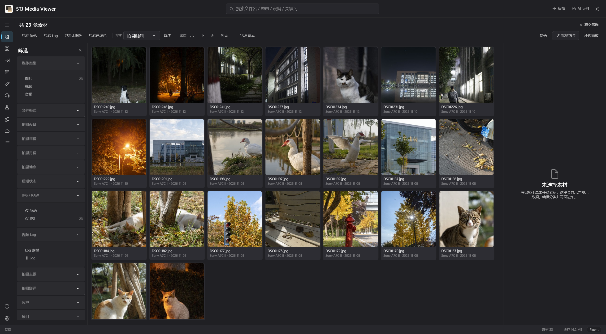

以前内容页把内容锁死在 1060～1240 DIP 并且强制 `MinWidth`：窗口放大后右边一大片空白，
缩小后内容被裁切 —— 看起来像"控件没有针对可变大小重绘"。现在：

| 区域 | 行为 |
| --- | --- |
| 内容页（设置 / 云同步 / 导入 / AI 队列 / 关于） | 随窗口拉伸，上限 1760 DIP 后保持左对齐；窗口变化立即重排 |
| 素材库左侧筛选栏 | 窗口 < 1000 DIP 自动收起；工具条「筛选」可手动开合 |
| 素材库右侧检视面板 | 窗口 < 1280 DIP 自动收起；「检视面板」可手动开合 |
| 素材网格 | 卡片数量随可用宽度自动增减（虚拟化面板不变） |
| 云同步状态 | 状态文本更新回到 UI 线程（修掉后台线程改 UI 的 `0x8001010E`） |

小窗口（1000×700）自动收起两侧面板：

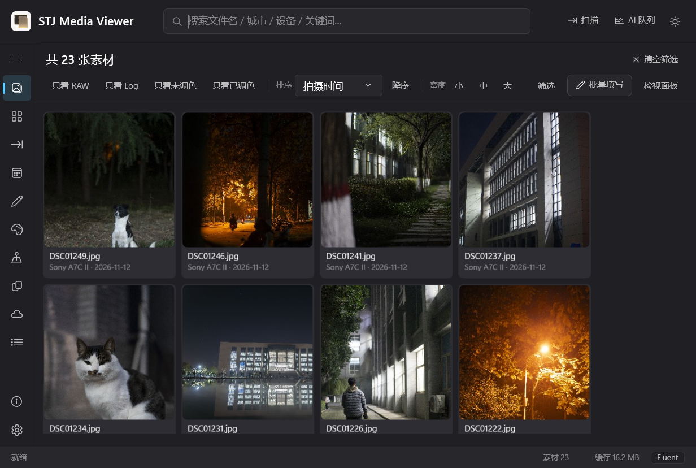

### 3.5 版本号与发行流程

当前版本 **v1.17.2**，历史见 [CHANGELOG.md](CHANGELOG.md)。

- 规则：每次对外更新都 **+1 版本号**（`1.17.1` → `1.17.2` → `1.17.3` → …），同步改应用/安装器/便携版/macOS Info.plist；
- 每次发版：`git tag v<版本>` + 推送到 GitCode + 创建发行版（Release）；
- 一键脚本（版本、构建、提交、打标签、推送、创建发行版）：

```powershell
$env:GITCODE_TOKEN = "<你的 GitCode 访问令牌>"
powershell -ExecutionPolicy Bypass -File tools/release.ps1 -Version 1.0.4 -Notes "本次更新内容"
```

- 仓库：<https://gitcode.com/TMR2333/stj-media-viewer>
- 发行版：<https://gitcode.com/TMR2333/stj-media-viewer/releases>
  - v1.17.2：安装包 + 便携版（Release 附件直下）

**每次更新都会：**改版本号 → 构建 → 提交 → 打 tag → 推送 → 建发行版并上传安装包/便携版。

