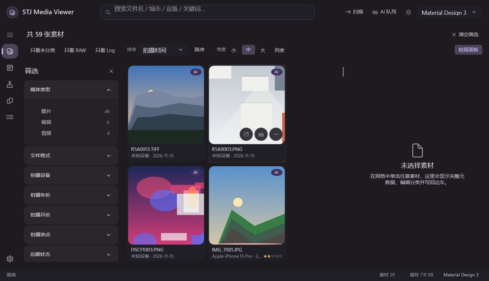
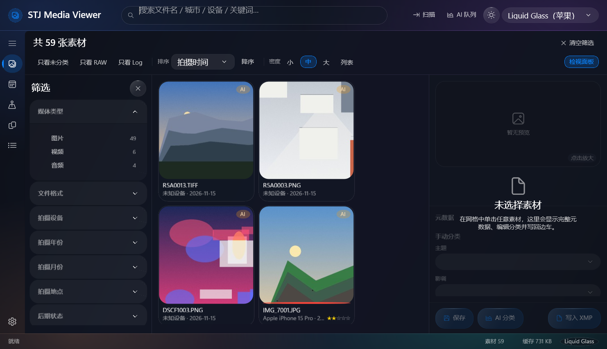
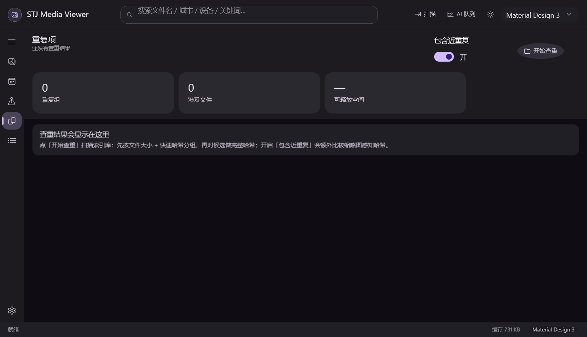

# stj-media-viewer

面向专业创作者的 **Windows 原生素材整理软件**。选一个媒体库文件夹，它递归扫描、排除非媒体、解析元数据、自动分类，并给你一个能按 9 个维度检索的素材库——同时**界面可以在 Fluent / Material Design 3 / Liquid Glass 三套设计语言之间实时切换**。

<p align="center">
  
  
</p>
<p align="center">
  
  
</p>
<p align="center">
  
  
  
</p>

> 三套皮肤不是换个主色：材质（Mica / 五级色调表面 / 背景光场+七层玻璃）、圆角尺度（4-12 / 12-28 / 10-32）、控件密度、字阶字重、状态反馈（6% hover / 8%-12% state layer / 渐变高光+sheen）全部不同。
> 截图由应用自身渲染导出（`STJ_CAPTURE=<png>` 环境变量），不依赖外部截屏工具。

---

## 1. 它解决什么问题

专业创作者的硬盘里通常躺着几万条素材：相机 RAW、手机 HEIC、无人机视频、Log 素材、现场录音、修过的成片和没修的原片混在一起，散落在 `2023/上海/`、`导出/`、`Desktop/` 之类的目录里。传统文件管理器只能按文件名和日期看，Lightroom/Capture One 又把你锁在单一后期工作流里。

这个软件把"素材整理"本身当成第一性问题：**先把素材变成结构化数据，再让你用任何维度去看它**。

## 2. 功能清单

### 2.1 扫描与排除

- 选择一个或多个媒体库文件夹，递归扫描（可关子目录）。
- **自动排除非媒体**：扩展名白名单 + 魔数嗅探（`.jpg` 里装的是文本会被识别为损坏而不是图片）、AppleDouble `._*`、隐藏文件、`Thumbs.db`/`.DS_Store`/`desktop.ini`、`$RECYCLE.BIN`、`System Volume Information`、`node_modules`、`.git`、临时文件（`.tmp/.part/.crdownload`）。
- 单文件解析失败不中断整体扫描：坏文件照样入库并标记 `LastError`，可用「只看问题」筛出来。
- 扫描进度实时（枚举 / 读元数据 / 写索引三段），可取消。
- 增量重扫：按完整路径 UPSERT，不会产生重复记录；同时清理已从磁盘消失的条目。

### 2.2 元数据引擎（自研，不依赖外部 exe）

| 类型 | 覆盖 |
|---|---|
| 图片 | JPEG / PNG / TIFF / HEIF / AVIF / WebP / BMP / GIF / PSD |
| RAW | CR2 / CR3 / NEF / NRW / ARW / SRF / RAF / ORF / RW2 / PEF / SRW / X3F / DNG / IIQ / 3FR / MOS / GPR … |
| 视频 | MP4 / MOV / M4V / MKV / WebM / MXF（基础）/ AVI（基础） |
| 音频 | WAV（含 RF64）/ MP3（ID3v2.2–2.4）/ FLAC / OGG / Opus / AIFF / M4A(AAC) |

解析内容：EXIF / IPTC / **XMP**（内嵌 APP1、TIFF tag 700、PNG iTXt、WebP、以及 `.xmp/.dop/.cos/.on1/.pp3/.arp` 边车）、ISOBMFF 盒子（时长/尺寸/帧率/编解码器/`colr` CICP/`udta` 的 make/model/GPS/creation_time/comment）、Matroska EBML、ID3/Vorbis 标签、**RAW 内嵌预览提取**（TIFF IFD 513/514 快路径 + 全文件流式扫描最大 JPEG，60MB 大 RAW 12ms）。

### 2.3 九个分类维度

| # | 维度 | 自动来源 | 手动 | AI |
|---|---|---|---|---|
| 0 | 大类（图片/视频/音频） | 扩展名 + 魔数 | — | — |
| 1 | 文件格式 | 扩展名 + 容器/编解码器 | — | — |
| 2 | 拍摄设备 | EXIF Make/Model、QuickTime、文件名 | ✓ | — |
| 3 | 拍摄时间 | EXIF DateTimeOriginal + 时区、QuickTime creation_time、文件时间兜底 | ✓ | — |
| 4 | 拍摄地点（城市） | GPS → **离线城市库**（31,701 城市，含中文名）；XMP `photoshop:City` 优先 | ✓ | — |
| 5 | 是否已后期调色 | XMP `crs:HasSettings`、边车存在、RAW+同名 JPG、文件名启发式 | ✓ 三态 | — |
| 6 | JPG / RAW（RAW 特殊标记） | 扩展名 + RAW 格式库 | — | — |
| 7 | 视频是否 Log | CICP transfer、相机型号、容器内字符串、XMP | ✓ | ✓ |
| 8 | 拍摄主题 | — | ✓ | ✓ 视觉模型 |
| 9 | 拍摄影调 | 直方图/饱和度/色温规则建议 | ✓ | ✓ 视觉模型 |

每个维度的取值都带**来源与置信度**（`Derived` / `Sidecar` / `Manual` / `Ai` + model id），界面上以徽标显示；**人工结果永远优先，AI 默认不覆盖人工值**。

### 2.4 AI 分类：接你自己的模型

- 只要求 **OpenAI 兼容协议**（`POST {BaseUrl}/chat/completions`），因此 OpenAI / Azure OpenAI / Ollama / vLLM / 任意自建网关都能用。
- 设置页填 BaseUrl、模型名、API Key（**DPAPI 加密**后落盘），「测试连接」直接告诉你延迟、模型回显或错误原文。
- 图片会先经 WIC 解码 + 缩放到 `MaxImageDimension`（默认 1024）再以 base64 上传；RAW 自动使用内嵌预览。
- `response_format` 三级回退：json_schema → json_object → 纯文本解析（兼容 markdown 代码块、中文引号、百分制分数等脏输出）。
- 批量队列：并发度可调、失败重试 + 指数退避、进度/耗时/成功率统计、结果可一键写回 XMP。
- **没有 API Key 也能验证全链路**：仓库自带 `tools/MockAiServer`（纯标准库 Python，确定性输出），设置页把 BaseUrl 指向 `http://127.0.0.1:8787/v1` 即可。

### 2.5 整理与输出

- 三栏素材库：**左侧 11 组分面筛选（带计数）+ 中间虚拟化网格 + 右侧检视面板**。
- 网格：小/中/大/列表四种密度、RAW/LOG/AI/时长徽标、颜色标签条、5 星评分、多选（Ctrl/Shift）、方向键导航、右键菜单、200 条/页滚动加载。
- 检视面板：大图预览、8 组元数据（带来源徽标）、手动分类（主题/影调/后期三态/城市/评分/色标/选用废片）、保存 / AI 分类此条 / 写入 XMP。
- 全屏预览：滚轮指针锚点缩放 0.1–8x、拖拽平移、双击 1:1、左右切图、视频/音频播放。
- 时间线（年/月/天）、地图（城市分布）、重复项（精确 + 近重复 aHash）、AI 队列。
- 批量导出（按 `{yyyy}/{city}/{device}` 模板分目录，可移动或复制，边车一起带走）、批量重命名（模板变量）、回收站删除。
- 重复检测：`size + 快速 FNV 指纹` 粗筛 → `SHA-256` 精确 → `8x8 aHash` 近重复。
- 缩略图磁盘缓存 + 内存 LRU；缓存大小可见、可清理。

### 2.6 界面与皮肤

- 三套设计语言运行时切换，**不重启**（WinUI 3 的 `ThemeResource` 对已实例化元素不刷新，所以切换时会重建视觉树）。
- 明暗模式：跟随系统 / 浅色 / 深色。
- 窗口背板随皮肤变：Fluent → Mica，MD3 → 纯色（MD3 的哲学是零透明），Glass → Desktop Acrylic。
- 全部界面只用语义 token（`{ThemeResource ...}`），页面里没有一处硬编码颜色/字号/圆角。

## 3. 快速开始

```powershell
# 环境：Windows 10 1809+ / Windows 11，.NET 10 SDK
git clone <repo> ; cd stj-m-v

# 1) 编译
dotnet build src/StjMediaViewer.App/StjMediaViewer.App.csproj

# 2) 运行（免安装运行时，self-contained）
.\src\StjMediaViewer.App\bin\Debug\net10.0-windows10.0.19041.0\win-x64\StjMediaViewer.exe
```

首次启动点顶部「扫描」→ 选一个素材文件夹。想先用测试数据体验：

```powershell
# 生成 85 个文件的真实测试素材库（含 EXIF/XMP/RAW/真实 H.264 视频/音频/反例/重复）
python tools/SampleLibrary/generate.py
# 把它扫进 App 的索引库
.\tools\Seed\bin\Debug\net10.0-windows10.0.19041.0\win-x64\StjMediaViewer.Seed.exe
```

ffmpeg 是可选的：把 `ffmpeg.exe` 放到 `tools/ffmpeg/bin/`（或 PATH）即可获得视频抽帧/代理转码；没有则降级到系统缩略图，不报错。

## 4. 工程与验证

```
src/StjMediaViewer.Core    # 无 UI 依赖：模型/契约/元数据/索引/扫描/解码/AI/地理/设置
src/StjMediaViewer.App     # WinUI 3：Views / ViewModels / Themes / Controls / Services
tools/SelfCheck            # 端到端自检（扫描→元数据→分类→查询→缩略图→去重→AI→导出→性能）
tools/SampleLibrary        # 测试素材库生成器（Python，幂等）
tools/MockAiServer         # 本地 OpenAI 兼容 mock 服务器（纯标准库）
tools/Seed                 # 把素材库扫进索引（命令行）
tools/MetaSmoke / MediaSmoke / dev
```

**验证结果**（本机 Windows 11 / .NET 10 / 85 文件样本库）：

| 指标 | 结果 |
|---|---|
| 端到端自检 | **69 项检查全部通过 / 0 失败**；其中 manifest 逐字段断言 **618/618 全过** |
| 真实 HTTP AI 链路 | 用本地 MockAiServer 实测：连接测试 / 单张分类 / 确定性 / 批量写回 全通过 |
| 59 个媒体文件全链路扫描 | 1 线程 308ms，8 线程 38ms（结果逐字段一致） |
| 单文件元数据解析 | 平均 3.3ms（稳态 <5ms），60MB RAW 预览提取 12ms |
| 1 万条素材入库 | 1.24–1.43s（约 7000 条/秒） |
| 筛选查询 | 2–10ms；分面统计 13–17ms |
| 缩略图 | 4678 张/分钟（目标 200/分钟），缓存命中 <1ms |
| 重复检测 | 58 条素材 319ms，精确 3 组 + 近重复 2 组 |
| 离线地理编码 | 31,701 城市 / 加载 48ms / 8 个 manifest 坐标全部命中 |

```powershell
# 自检
dotnet build tools/SelfCheck/StjMediaViewer.SelfCheck.csproj
.\tools\SelfCheck\bin\Debug\net10.0-windows10.0.19041.0\win-x64\StjMediaViewer.SelfCheck.exe
```

## 5. 设计语言系统

界面只认**语义 token**，不认具体皮肤：

- `App/Themes/Tokens.Base.xaml` 定义全量键（颜色/圆角/字号/动效/控件尺寸）作为兜底与契约。
- `Tokens.Fluent.xaml` / `Tokens.Md3.xaml` / `Tokens.Glass.xaml` 用**同名键**覆盖，另含各 ~140 个 WinUI 框架资源键（`NavigationView*`、`TextControl*`、`ComboBox*`、`Button*`…），所以标准控件也跟着皮肤变。
- `Controls.Md3.xaml` / `Controls.Glass.xaml` 承载**结构性差异**（MD3 的 pill/tonal 按钮、Glass 的镜面描边按钮与玻璃胶囊）。
- `DesignLanguageService` 运行时替换 `MergedDictionaries` → 持久化 → 换窗口背板 → **重建视觉树**，无需重启。

细节见 [docs/THEME-TOKENS.md](docs/THEME-TOKENS.md) 与 [docs/ARCHITECTURE.md](docs/ARCHITECTURE.md)。

## 6. 已知限制

- 暂未深度解析：AVI / MXF / BRAW / R3D / CRM / INSV / MPEG-TS（只给扩展名 + warning）；PSB 不做图层解析。
- 真实相机 HEIC 的 EXIF/XMP 若在 `iloc` 引用的 item 里，走特征扫描兜底（限 64MB）。
- 城市反查用离线 GeoNames cities15000（31,701 城市，含中文名）：极少数坐标会落到邻近区县；非中国城市的 `Province` 仍是 admin1 代码。
- 视频色彩字段用可读名（`HLG` / `S-Log3` / `BT.709`），与 ffprobe 的 `arib-std-b67` 之类原始枚举名不同（仅命名口径差异）。
- 批量 AI 分类的 token 用量未落库（只统计本次运行）。
- 未做 HighContrast 主题；未内置 Roboto / Noto Sans SC（MD3 暂用 Segoe UI Variable），接入步骤写在 `docs/THEME-TOKENS.md`。
- Glass 皮肤的 `ThemeShadow` 在 ScrollViewer 边缘可能被裁剪（WinUI 限制）。
- 时间线一次构建全部日桶（1 万条约 1000 天，已折叠到月份里），超大库建议改成按月懒加载。
- AI 队列的"暂停"是取消当前批次并保留进度，不是协程级暂停。
- 没有 GPU 加速的图片渲染（WIC 解码 + XAML 虚拟化），10 万级库需要分库或增量加载策略。

## 7. 开源致谢

| 项目 | 用途 | 许可 |
|---|---|---|
| [MetadataExtractor](https://github.com/drewnoakes/metadata-extractor-dotnet) | EXIF/IPTC/ICC 解析 | Apache-2.0 |
| [FFmpeg](https://ffmpeg.org/) | 视频抽帧、代理转码（外部可执行，不静态链接） | LGPL/GPL |
| [GeoNames cities15000](https://download.geonames.org/export/dump/) | 离线反向地理编码 | CC BY 4.0 |
| [Microsoft.Data.Sqlite](https://learn.microsoft.com/dotnet/standard/data/sqlite/) | 索引库 | MIT |
| [CommunityToolkit.Mvvm](https://github.com/CommunityToolkit/dotnet) | MVVM | MIT |
| [ExifTool 标签文档](https://exiftool.org/TagNames/) / [ISO/IEC 14496-12](https://www.iso.org/standard/83102.html) | 标签与容器语义参考 | — |
| [Material Design 3](https://m3.material.io/) · [Fluent 2](https://fluent2.microsoft.design/) · [Apple HIG](https://developer.apple.com/design/) | 三套设计语言规范 | — |

> sf pro / SF Symbols 受 Apple 许可限制，未随本项目分发；Liquid Glass 皮肤使用系统字体与自绘图标。